# TUPÃ Fortran reference model: main workflow

Source: `carloskleber/tupa_ref` @ `680e210`, paths relative to `fortran/`.

```mermaid
flowchart TD
    %% ---------- Entry ----------
    A["program main<br/>app/main.f90:1"] --> A1["CLI flags: setVerbosity, setQuadEpsRel,<br/>setGeometryKernel, setDefaultImageModel,<br/>geomCacheSetEnabled, omp_set_num_threads<br/>app/main.f90:86-155"]
    A1 --> B["runFromFile<br/>src/Tupa.f90:1181"]

    %% ---------- Input ----------
    subgraph IN["Input"]
        B --> C["loadStudy<br/>src/Tupa.f90:159"]
        C --> C1["parseJsonFile → tJsonValue tree<br/>src/JsonParser.f90:73"]
        C1 --> C2["soil: linear / portela / alipio-visacro<br/>src/Tupa.f90:274-291 · src/Material.f90"]
        C2 --> C3["nodes → structure%addNode<br/>src/Tupa.f90:350"]
        C3 --> C4["materials → structure%addMaterial<br/>src/Tupa.f90:364"]
        C4 --> C5["elements: line / catenary / channel / mesh<br/>→ structure%addElement<br/>src/Tupa.f90:373-502"]
        C5 --> C6["sources, frequencies, outputs,<br/>signal, observation blocks<br/>src/Tupa.f90:520-790"]
        C6 --> D["validateStudyReferences<br/>src/Tupa.f90:1039"]
    end

    %% ---------- Segmentation ----------
    subgraph SEG["Geometry / segmentation"]
        D --> E["structure%assembleStructure<br/>src/Structure.f90:364"]
        E --> E1["elem%assemble polymorphic:<br/>assembleLine element/Line.f90:74<br/>assembleCatenary element/Catenary.f90:80<br/>assembleChannel element/Channel.f90:234<br/>assembleMesh element/Mesh.f90:128"]
        E1 --> E2["nodes + electrodes (segments)<br/>registered in tStructure"]
    end

    E2 --> F{"sources + frequencies?<br/>signal?<br/>src/Tupa.f90:1262-1263"}
    F -- "neither" --> Z0["assembleStructure + study%report<br/>structure-only case<br/>src/Tupa.f90:1346-1349"]
    F -- "harmonic sweep" --> G["study%runSweep<br/>src/Study.f90:664"]
    F -- "transient" --> T["transientResponseSignals / Sources<br/>src/Transient.f90:414 / 375"]

    %% ---------- Frequency-independent preparation ----------
    subgraph PREP["One-time preparation (frequency-independent)"]
        P["prepareStudy<br/>src/Study.f90:132"]
        P --> P1["buildGeometryMatrices G, Gi, Rbar, Rbari,<br/>cosθ, cosθi<br/>src/Geometry.f90:306"]
        P1 --> P2["selfGeometryFactor src/Geometry.f90:88<br/>mutualGeometryFactor src/Geometry.f90:109"]
        P2 --> P3["geomCacheGet/Put src/GeometryCache.f90<br/>geometryFactor1D src/Impedance.f90:266<br/>geometryFactor2D → TWODQ src/Impedance.f90:229/389"]
        P3 --> P4["initMesh src/Mesh.f90:158<br/>calcTopology src/Mesh.f90:188"]
    end
    G --> P
    P4 --> L

    %% ---------- Frequency loop ----------
    subgraph LOOP["Per-frequency loop (OpenMP over k), src/Study.f90:741-767"]
        L["solveAtFrequency<br/>src/Study.f90:442"] --> M["fillAtFrequency<br/>src/Study.f90:478"]
        M --> M1["media: calcParamW src/Mesh.f90:237<br/>or calcParamLaplace src/Mesh.f90:262<br/>material%admittance ω or s"]
        M1 --> M2["segmentInternalImpedance skin effect<br/>src/Study.f90:215"]
        M2 --> M3["calcZSelf src/Mesh.f90:309<br/>calcZMutual src/Mesh.f90:358<br/>→ Zlong, Ztrans"]
        M3 --> M4["calcFreq2: augmented Zeq,<br/>size nno + 2·nseg<br/>src/Mesh.f90:409"]
        M4 --> S{"any voltage source?"}
        S -- "no" --> S1["injectSignal → ZGESV<br/>src/Mesh.f90:446"]
        S -- "yes" --> S2["solveWithVoltageSources<br/>injectSignals multi-RHS + small ZGESV<br/>src/Study.f90:536 · src/Mesh.f90:486"]
        S1 --> R["voltage, current1, current2<br/>→ tVoltages / tLongCurrents / tTransCurrents<br/>src/Result.f90"]
        S2 --> R
    end

    %% ---------- Harmonic post-processing ----------
    subgraph OUT["Post-processing / output"]
        R --> O1["study%report<br/>src/Study.f90:936"]
        O1 --> O2["writeResultsCsv src/ResultsWriter.f90:62<br/>writeResultsJson src/ResultsWriter.f90:183<br/>→ base_results.csv/.json"]
        O2 --> O3{"observation block?"}
        O3 -- "yes" --> O4["computeObservations src/Potentials.f90:129<br/>→ potentialsAt src/Potentials.f90:54<br/>ψ, GPR, touch, step"]
        O4 --> O5["writeObservationCsv/Json<br/>src/ResultsWriter.f90:608/675<br/>→ base_potentials.csv/.json"]
    end

    %% ---------- Transient path ----------
    subgraph TR["Transient path, FFT or NLT"]
        T --> T1["sample waveform on time axis, taper/window<br/>sampleTimeAxis src/Transient.f90:71<br/>hannHalfWindow src/Transient.f90:149"]
        T1 --> T2["fftForward src/Fft.f90:41<br/>src/Transient.f90:567"]
        T2 --> T3["tukeyAntialiasFilter<br/>src/Transient.f90:108"]
        T3 --> T4["study%runSweepUnits: unit-terminal<br/>transfer functions H<br/>src/Study.f90:788"]
        T4 -. "per frequency:<br/>prepareStudy, fillAtFrequency,<br/>injectSignals src/Study.f90:851-852" .-> P
        T4 --> T5["toBins / pchipInterpolate<br/>src/Transient.f90:716 / 184"]
        T5 --> T6["H·X spectrum product →<br/>spectrumToTimeSeries → fftInverse<br/>src/Transient.f90:771 · src/Fft.f90:48"]
        T6 --> T7["writeTransientSignalsCsv/Json src/ResultsWriter.f90:479/524<br/>or writeTransientResultsCsv/Json src/ResultsWriter.f90:294/367<br/>→ base_transient_results.csv/.json"]
    end

    O3 -- "no" --> END
    O5 --> END
    T7 --> END
    Z0 --> END
    END["Simulation duration printed<br/>src/Tupa.f90:1352-1354"]
```

Notes:
- The sweep runs before the transient when both are present (`src/Tupa.f90:1266-1286`), because `transientResponse*` calls `runSweepUnits` and would overwrite the stored sweep results.
- `prepareStudy` is guarded by `this%prepared`, so geometry factors (the O(n²) quadrature) are built once and reused for every frequency.
- After the parallel loop, `runSweep` re-runs the last frequency serially (`src/Study.f90:774`) so `this%mesh` holds the final-frequency state, as the serial version did.
