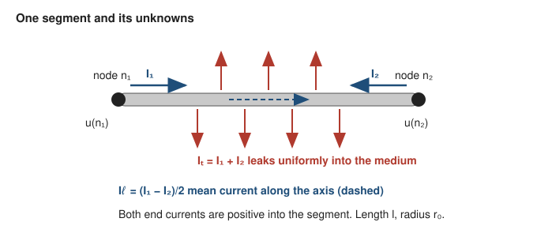

# 1. Model overview

[Theory index](../theory.md) · previous: [Reader's guide](guide.md) · next: [§2 Conventions](s02-conventions.md)

> **Summary.** Thin wires are cut into segments. Each segment has a current
> along its axis and a current leaking from its surface. Two dense matrices
> per frequency, $Z_\ell$ and $Z_t$, hold the electromagnetic coupling between
> all segments, and Kirchhoff's laws close the system.

TUPÃ implements the Hybrid Electromagnetic Model (HEM), an application of the
Method of Moments (MoM) to lightning and grounding-system transients. The
formulation follows Portela [1] and the author's dissertation [3], with the
matrix assembly as used by Salari et al. [4] and validated against Visacro &
Soares [5]. Alípio's dissertation [22] derives the same HEM in detail in both
time and frequency domains and is a useful companion text.

## 1.1 Discretisation

A network of thin cylindrical conductors (in air, buried in soil, or both) is
discretised into **segments** (also called electrodes) connected at **nodes**.
Each segment $j$ carries:

- a **longitudinal current** flowing along its axis, represented by the currents
  at its two ends, $I_1(j)$ and $I_2(j)$;
- a **transversal current** $I_t(j)$ leaking from its lateral surface into the
  surrounding medium (conduction plus displacement current), assumed uniformly
  distributed along the segment.

Each node $k$ has a scalar potential $u(k)$, the voltage to remote earth.

The two currents are tied by charge conservation. Whatever enters the segment
at its ends and does not come out must leak: $I_t = I_1 + I_2$ with both end
currents counted into the segment (§2). The current along the axis therefore
varies from $I_1$ at one end to $-I_2$ at the other, and the model uses its
mean, $I_\ell = (I_1 - I_2)/2$.

## 1.2 Coupling matrices

The electromagnetic coupling between every pair of segments is condensed into
two full complex matrices at each angular frequency $\omega$:

- $Z_t$, transversal ($n_s \times n_s$): mean scalar potential on segment $a$
  per unit transversal current leaked by segment $b$;
- $Z_\ell$, longitudinal ($n_s \times n_s$): voltage drop along segment $a$ per
  unit longitudinal current in segment $b$.

$Z_t$ plays the part of the shunt elements of a circuit (conductance and
capacitance to the medium), and $Z_\ell$ the part of the series elements
(resistance and inductance). The difference from a circuit model is that both
matrices are full: every segment is coupled to every other one, with the
delay and attenuation of the wave travelling between them.

Circuit-type (Kirchhoff) relations between node voltages and segment currents
close the system (§6), which is solved once per frequency. Time-domain
responses are obtained by an inverse Fourier or Laplace transform of the
frequency sweep (§8).

## 1.3 What "hybrid" means, and what is assumed

The model is hybrid because the couplings come from field theory (retarded
potentials, §3) while the unknowns and the closing equations are those of a
circuit (node voltages, branch currents, Kirchhoff's current law). In the
language of the Method of Moments, each segment carries a pulse basis
function, and the potentials are matched on segment averages (cf.
Harrington [6], Gibson [7]).

The premises, each discussed where it is used:

| Premise | Consequence | Section |
| --- | --- | --- |
| Thin wires: radius much smaller than segment length and wavelength | currents are filaments on the axis; fields are evaluated on the surface | §3, §4.1 |
| Uniform currents within a segment | segments must be short against the wavelength (about $\lambda/10$) | §4.1 |
| Propagation factor taken at the midpoint distance | the geometry integrals become frequency independent | §4.1 |
| Two homogeneous half-spaces, quasi-static images | valid up to a few MHz for typical grounding systems | §5 |
| Linear media | no soil ionisation, corona or arresters; frequency-domain solution | §8, §10 |

It is a frequency-domain, full-wave method for thin-wire structures:
retardation and attenuation in dissipative media are kept, and no
transmission-line or quasi-static assumption is made on the wires themselves.

## Check yourself

- For a segment with $I_1 = 1$ A and $I_2 = -1$ A, what are $I_\ell$ and
  $I_t$? (1 A and 0: the current passes through, nothing leaks.)
- For $I_1 = 1$ A and $I_2 = 0$? (0.5 A and 1 A: everything leaks, which is
  the single-segment rod of the [worked example](worked-example.md).)
- How many unknowns has a structure of 100 segments and 101 nodes? ($101 + 200$.)
