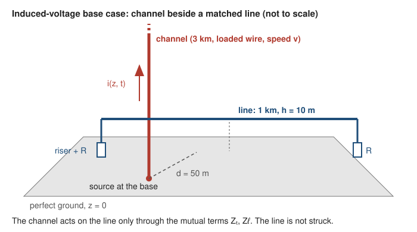

# 4.6 Lightning-induced voltages on nearby lines

[Theory index](../theory.md) · previous: [§4.5 Lightning channel](s04-5-lightning-channel.md) · next: [§5 Image method](s05-interface.md)

> **Summary.** A lightning stroke near a line that it does not hit still
> induces a voltage on it. The literature computes it in two steps: a
> return-stroke model gives the fields, and a transmission-line coupling model
> gives the voltage. In the HEM the channel and the line are segments of one
> system and the coupling is the ordinary mutual impedance. This chapter maps
> one description onto the other and fixes the validation case. The claim
> holds for a perfectly conducting ground.

Decisions: [ADR 0028](../adr/0028-induced-voltages-and-lumped-branch.md).
The channel (§4.5) and the line wires need no new geometry. The one new piece
is the lumped termination of §6 (the series-RLC `branch`), which a matched
line needs. The validation anchor is item 9 of §9, and its numbers are in
[validation/induced-validation.md](../validation/induced-validation.md).

§4.5 puts the channel on top of the struck object, whose response is the
goal. Here the channel ends on the ground (or on any structure) at a
distance $d$ from an overhead line that is **not** struck. The line sees only
the channel's fields, and the wanted quantities are the voltages at its
terminations and along it. The engineering literature solves this in two
steps: a return-stroke model turns the measured channel-base current into
fields, and a transmission-line coupling model turns the fields into line
voltages [75–77]. The HEM solves both in one linear system. This section does
three things:

1. collects the field and coupling theory of the two-step procedure, so that
   a TUPÃ result can be mapped onto the published ones (§4.6.1–§4.6.2);
2. states what the HEM line model contains and what it leaves out
   (§4.6.3–§4.6.4);
3. fixes the validation anchor (§4.6.5).

Sources: the base case and its parametric study are Nucci et al. [75]. The
CIGRE review [76] covers return-stroke models and fields, and its companion
[77] the coupling models. Rachidi et al. [78, 79] treat the lossy ground.
The dipole fields are Master et al. [80], and the TL model comes from
Uman & McLain [81]. The coupling equations go back to Agrawal et al. [82],
and Rachidi's review [85] is their modern statement. Field data come from
Rubinstein et al. [83] and Barker et al. [84]. [86–99] cover what the
perfect-ground anchor leaves out: corona, lossy and dispersive ground,
inclined channels, grounding, sag and terrain. Several printed equations in
these papers are wrong; the verified forms are used below and the errata are
listed at the end of §4.6.5.

## 4.6.1 Fields of the channel

Take a vertical channel on the $z$ axis with its base at the ground, and an
observation point at horizontal distance $r$ and height $z$. The channel
carries $i(z',t)$. Over a perfect ground the image channel carries the
current in the same direction, so a vertical dipole $dz'$ at height $z'$ and
its image give the field as an integral over $z' \in [-H, H]$. Write
$R = \sqrt{r^2 + (z-z')^2}$ and evaluate every current at the retarded time
$t - R/c$. Solving Maxwell's equations through the retarded Lorenz-gauge
potentials gives, for one dipole [80, 76],

$$dE_z = \frac{dz'}{4\pi\varepsilon_0}\left[\frac{2(z-z')^2 - r^2}{R^5}\int_0^t i\,d\tau
+ \frac{2(z-z')^2 - r^2}{cR^4}\, i - \frac{r^2}{c^2R^3}\frac{\partial i}{\partial t}\right]$$

$$dE_r = \frac{dz'}{4\pi\varepsilon_0}\left[\frac{3r(z-z')}{R^5}\int_0^t i\,d\tau
+ \frac{3r(z-z')}{cR^4}\, i + \frac{r(z-z')}{c^2R^3}\frac{\partial i}{\partial t}\right]$$

$$dB_\varphi = \frac{\mu_0\, dz'}{4\pi}\left[\frac{r}{R^3}\, i + \frac{r}{cR^2}\frac{\partial i}{\partial t}\right]$$

The three bracket terms are the electrostatic term (it follows the charge
moment $\int i\,d\tau$), the induction term and the radiation term. The signs
of the radiation terms follow from the projection of $\hat z$ transverse to
the ray: its $z$ part is $r^2/R^2$ and its $r$ part is $-r(z-z')/R^2$, and the
radiation field is $-\mu_0/(4\pi R)\,\partial i/\partial t$ times that
projection.

Two consequences matter below. Over a perfect ground the vector potential of
the channel and its image is purely vertical, so the horizontal field is a
pure scalar-potential gradient, $E_r = -\partial\varphi/\partial r$. And
$E_r$ is zero at the ground and grows about linearly with height, because
it is the small difference between the dipole and its image at different
distances and retardations [75, 78].

**Return-stroke models with a specified channel-base current.** The current
along the channel is tied to the measurable $i(0,t)$ by an engineering model
[76]; the original side-by-side comparison of these models is [126]. The table lists the ones used in the induced-voltage literature (the
current is zero for $z' > vt$):

| Model | $i(z',t)$ for $z' \le vt$ | Remarks |
| --- | --- | --- |
| Bruce–Golde (BG) | $i(0,t)$ | discontinuous front; removes charge instantly |
| Transmission line (TL) [81] | $i(0,\,t - z'/v)$ | no net charge removed |
| Modified TL (MTL) [75, 76] | $e^{-z'/\lambda}\, i(0,\,t - z'/v)$ | $\lambda \approx$ 1.5–2 km (1.7 km in [75]) accounts for the corona-sheath charge |
| Travelling current source (TCS) | $i(0,\,t + z'/c)$ | source climbs at $v$, current falls at $c$ |
| MULS [80, 127] | uniform + breakdown pulse $e^{-z'/\lambda_p}$ + corona current | with equal decay constants it equals MTL apart from the uniform current [128, 76] |
| Diendorfer–Uman (DU) | two discharge processes ($\tau_{bd} \approx 0.6$ µs, $\tau_c \approx 5$ µs) | most elaborate; more parameters |

**Channel-base current.** Both [75] and [76] use a sum of Heidler-type
functions [37]

$$i(0,t) = \sum_k \frac{I_{0k}}{\eta_k}\,\frac{(t/\tau_{1k})^{n_k}}{1 + (t/\tau_{1k})^{n_k}}\,e^{-t/\tau_{2k}},
\qquad \eta_k = \exp\!\left[-\frac{\tau_{1k}}{\tau_{2k}}\left(\frac{n_k\tau_{2k}}{\tau_{1k}}\right)^{1/n_k}\right],$$

which, unlike the double exponential, has zero slope at $t = 0$. The
typical negative **subsequent** stroke of [75, 76] is the two-term case
$n_1 = n_2 = 2$ with $(I_{01}, \tau_{11}, \tau_{21}) = (10.7\ \text{kA},\ 0.25\ \mu\text{s},\ 2.5\ \mu\text{s})$
and $(I_{02}, \tau_{12}, \tau_{22}) = (6.5\ \text{kA},\ 2.1\ \mu\text{s},\ 230\ \mu\text{s})$.
It reproduces the 50 % values of Berger's statistics [124] (Table II of [75],
identical to Table I of [76]: 4.6/12/30 kA and 12/40/120 kA/µs at 95/50/5 %). Recomputed here the
sum peaks at 12.01 kA (0.81 µs), its steepest slope is 40.08 kA/µs
(0.135 µs) and it carries 1.4 C. The tail constant $\tau_{22}$ barely
moves the peak: 280 µs, the value in Table 11.1 of Cooray [74], gives
12.00 kA and 40.07 kA/µs, only the charge (1.6 C) changes. The two sources
disagree here; [76] and [75] print 230 µs, and so does the De Conti & Visacro
set [38]. TUPÃ uses 230 µs, and the case is not sensitive to it.
Note that §IV-A of [75] says "50 kA/µs", a slip against the 40 kA/µs
printed in its own Tables II–III and recomputed above.

**Where the TUPÃ channel sits.** The loaded wire of §4.5 is a TL-type
representation with a distributed series loss. Its current is *solved*, not
prescribed, so the base current is the source current but the current
higher up follows from the wire. With the attenuation of §4.5,
$\alpha \approx R'/(2Z_c)$, the MTL decay $e^{-z'/\lambda}$ is matched to
first order by

$$R' \approx \frac{2 Z_c}{\lambda},$$

about 1.7 Ω/m for the base case below ($r_0 = 3$ cm, $v = 1.3\times10^8$ m/s,
$Z_c \approx 1.44$ kΩ at $z = 500$ m, $\lambda = 1.7$ km). The same
speed calibration as §4.5 gives $L' \approx 9\ \mu$H/m. The match is only to
first order and in amplitude. MTL scales every frequency alike, whereas the
loaded wire adds antenna-mode dispersion and radiation, the precursor at $c$,
and the reaction of the line currents on the channel. The reference
procedure has none of these. The comparison in §4.6.5 therefore measures
HEM-plus-loaded-channel against MTL-plus-Agrawal, and the tolerance has to
include the spread between return-stroke models themselves: with the same
channel-base current, TCS and MTL differ by 12 % in peak voltage and 37 % in
front steepness in [75] (Table IV: 74 vs 66 kV, 260 vs 190 kV/µs).

## 4.6.2 Field-to-line coupling formulations

Take a lossless wire of radius $a$ along $x$ at height $h$ over a perfect
ground, with
$L' = \dfrac{\mu_0}{2\pi}\cosh^{-1}\dfrac{h}{a} \simeq \dfrac{\mu_0}{2\pi}\ln\dfrac{2h}{a}$,
$C' = \dfrac{2\pi\varepsilon_0}{\cosh^{-1}(h/a)}$ and $Z_c = \sqrt{L'/C'} \simeq 60\ln(2h/a)\ \Omega$
($498\ \Omega$ for $a = 5$ mm, $h = 10$ m). The **incident** field is that of
the channel plus the ground-reflected field, both computed without the wire.
The **scattered** field is the reaction of the wire's currents and charges, and the
total is their sum. The three coupling models used for induced voltages
follow from one Faraday-law balance [77].

*Total voltage and Taylor's form.* Define the total voltage
$u(x,t) = -\int_0^h E_z\,dz$. Faraday's law on the rectangle $[x, x+dx]\times[0,h]$
has the tangential field vanishing on the wire and on the ground. The
magnetic flux through the rectangle is the wire's own flux, $L' i$, plus
the incident flux, so

$$\frac{\partial u}{\partial x} + L'\frac{\partial i}{\partial t} = -\frac{\partial}{\partial t}\int_0^h B^i_y\,dz,
\qquad
\frac{\partial i}{\partial x} + C'\frac{\partial u}{\partial t} = -C'\frac{\partial}{\partial t}\int_0^h E^i_z\,dz.$$

The second equation is current continuity together with $q = C'u^s$ for the
scattered voltage (see below).

*Agrawal's form.* Faraday's law for the *incident* field alone, using that its
horizontal component vanishes on the ground, gives

$$\frac{\partial}{\partial t}\int_0^h B_y^i\,dz = -E^i_x(x,h,t) + \frac{\partial}{\partial x}\int_0^h E_z^i\,dz.$$

Define the incident voltage $u^i = -\int_0^h E_z^i\,dz$ and the scattered
voltage $u^s = u - u^i$. Substituting into Taylor's first equation leaves

$$\frac{\partial u^s}{\partial x} + L'\frac{\partial i}{\partial t} = E^i_x(x,h,t),
\qquad
\frac{\partial i}{\partial x} + C'\frac{\partial u^s}{\partial t} = 0,$$

the Agrawal–Price–Gurbaxani pair [82; 77, 75]. Agrawal et al. derived it for
nuclear-EMP excitation of a multiconductor line, not for lightning [82]. The
horizontal incident field at
the wire height is a distributed voltage source. The vertical field enters
through the incident voltage $u^i$ and through the boundary conditions. Rachidi's
form, in which only $B$ appears explicitly, is a third algebraic rearrangement;
all three are equivalent within the transmission-line approximation. Rachidi
[85] derives all three from the thin-wire integral equations, which is
also the starting point of the HEM.

*Terminations.* A termination $R_A$ at $x = 0$ and $R_B$ at $x = l$ is reached
through a vertical wire (a **riser**) of height $h$, which is itself exposed
to $E_z^i$. For the total voltage the boundary conditions are the circuit
ones, $u(0,t) = -R_A\,i(0,t)$ and $u(l,t) = R_B\,i(l,t)$. In scattered
voltage, $u^s(0,t) = -R_A\,i(0,t) + h E^i_z(0,0,t)$, and likewise at $l$, so
the riser contributes a source. **At the terminations the total voltage is
$R\,i$**: the incident voltage and the riser term cancel. That makes the
termination voltage the one observable that does not depend on the
formulation.

*Other formulations in the power literature.*

- **Chowdhuri–Gross** keep the total voltage and write
  $\partial u/\partial x + L'\,\partial i/\partial t = 0$, dropping the
  right-hand side of Taylor's first equation. Combining the two relations
  above, the dropped term is
  $E_x^i(x,h,t) + \partial u^i/\partial x$. [77] (eq. 27) shows this and
  we re-derived it here. The omission can underestimate the voltage: for a
  500 m line with the stroke on its prolongation, 50 m from one end, the
  Chowdhuri–Gross equations give 19 kV where Agrawal and Taylor give
  33 kV [75].
- **Rusck** writes the same equations for the *total scalar potential*
  $\varphi$ and the incident potential $\varphi^i$, with total voltage
  $u = \varphi + \int_0^h \partial A^i_z/\partial t\,dz$, and a first equation
  that omits the incident vector-potential source
  $-\int_0^h \partial A_x^i/\partial t\,dz$. For a **vertical channel over
  perfect ground** $A_x^i = 0$, so Rusck's model and Agrawal's give the same
  voltage [77].
- The earlier paper [75] calls the Chowdhuri–Gross pair "Rusck's"; the later
  review [77] reassigns the name. Read the two with that in mind.

A consequence: "the contribution of the horizontal field" has no meaning
without naming the formulation. In Agrawal's form it is the distributed
source $E^i_x$; in Taylor's it is shared between $B$ and $E_z$; in
Rusck's it is absent (the vertical-channel horizontal field is a scalar-potential
gradient and sits in $\varphi^i$). The fractions of [75] Fig. 9 and [77]
Fig. 9 against Fig. 11 (same totals, different splits) are formulation
bookkeeping, not physics.

*Domain of validity.* The TL approximation needs $h$ and the line spacing
well below the shortest wavelength: for $h = 10$ m, $\lambda = 10h$ at 3 MHz,
which bounds the useful spectrum of the whole procedure. The quasi-static
alternative [77] is unusable because lines are many wavelengths long, and the
rigorous alternative, antenna theory, was dismissed in 1995 as computationally
prohibitive for km-long lines [77]. The HEM is antenna theory with a
circuit closure, and §4.6.3 shows what that gives.

*Field evidence.* Master & Uman [129] first applied the Agrawal equations to
a power line, against their own measurements on a 460 m line near Tampa
[130]. The computed waveshapes and the dependence of polarity on the bearing
of the stroke were right, and the amplitudes were several times too low,
which is attributed mainly to the wave-tilt approximation of the horizontal
field (§4.6.4) and not to the coupling equations. Rubinstein et al. [83] then tested the model with a measured
field: 450 m of three-phase line, distant strokes, and
the measured vertical field driving the computation. The waveshapes matched,
the 2ℓ/c oscillation came from the horizontal field, and the amplitudes were
uneven (−37 % and +19 % on the first peak in the two records shown). Paolone
et al. [133] review the later validations, from EMP simulators and the
reduced-scale model [93] to triggered lightning. Barker
et al. [84] triggered strokes 145 m from a 682 m test line. The induced
peaks were linear in the stroke current and about 63 % above Rusck's
simplified peak formula. The telegrapher-equation coupling itself was
consistent with the measured fields. The shortfall lay in the return-stroke
part of the simple formula, which is the same split that §4.6.1 and §4.6.5
make between the channel model and the coupling.

## 4.6.3 The HEM line model

Channel and line are ordinary segments in one system (§6), so none of the
source terms above is imposed. The incident field enters through the
mutual terms $Z_t(a,b)$ and $Z_\ell(a,b)$ of §5, image included.

*Which coupling acts.* A vertical channel segment (image included) and a
horizontal line segment are orthogonal, so $\cos\theta = 0$ in the
$Z_\ell$ formula of §5: the channel does not drive the line through the
vector potential. It acts only through the transversal path, the scalar potential of the charge
distribution on the channel. Hence the incident horizontal field the
wire sees is exactly $E_x^i = -\partial\varphi^i/\partial x$ (as in
§4.6.1), and the HEM line equations have the **Rusck structure**,
$\partial\varphi/\partial x + L'\,\partial i/\partial t = 0$ with the incident
scalar potential as forcing. For this geometry Rusck and Agrawal are equivalent
(§4.6.2), so the HEM is neither more nor less rigorous in the TL limit.
The nodal unknown $u(k)$ is the scalar potential $\varphi$ at the
node, relative to remote earth (the ground plane for ideal images), not the
Agrawal total voltage. They differ by the vertical vector-potential
integral:

$$u_{\text{line}}(x,t) = \varphi(x,t) + \int_0^h \frac{\partial A^i_z(x,z,t)}{\partial t}\,dz .$$

*The consequences for terminations.* A lumped resistor between the line's
end node and remote earth carries $\varphi$ at that node. The boundary
condition is Rusck's without the riser term, the $h_{riser} \to 0$ limit.
The literature's termination, a vertical wire plus a resistor at its foot, adds
$\int \partial A_z^i/\partial t\,dz$ over the riser. Both are well defined and they
differ. Two HEM constructions follow, and §4.6.5 runs both:

- **A.** The resistor sits directly at the wire end (no riser).
- **B (like-for-like).** A vertical wire from the line end down to the ground,
  with the resistor at its foot. The channel couples to the riser through
  $Z_\ell$ (parallel segments), so the vertical-field term appears by itself
  and $R\,i$ at the foot is the termination voltage of the reference.

*Interior points.* By default TUPÃ reports $\varphi$ at a node, and the
reference reports the total voltage $u$. With `signal.totalVoltage` the transient
driver adds the missing term, per frequency and for every observed node above the
ground,

$$u(x,y) = \varphi(x,y,h) + s\int_0^h A^i_z(x,y,z)\,dz,$$

where $A^i$ is the vector potential of the *incident* sources: the series-loaded
channel segments of §4.5 and their images, with the solved mean segment current
$I_b = (i_1 - i_2)/2$. Written with the kernel of the impedance fill
(`calcZMutual`, §5) and the field point moved onto the vertical path,

$$s\,A_z(P) = \sum_b \frac{s\mu_0}{4\pi}\,I_b\,u_{z,b}\left[e^{-\gamma R_b}\,g_b(P) - \Gamma\,e^{-\gamma R_{b,i}}\,g_{b,i}(P)\right],
\qquad g_b(P) = \int_b \frac{d\ell}{|P - \mathbf r(\ell)|},$$

with $g$ the closed form of §4.2 for a point off the axis, $R_b$ and $R_{b,i}$ the
distances to the midpoints of the segment and its mirror image, and
$-\Gamma = +1$ for the ideal ground (the image of a vertical current is a
vertical current in the same direction). Horizontal segments do not contribute.
The path is integrated with 4-point Gauss–Legendre panels no longer than 10 m. Only the
channel is incident: the line, its risers and any structure carry the scattered
field, which the TL formulation of §4.6.2 also leaves out of $u$. Two limits
follow. A node at or below the ground is returned unchanged (no vertical path in
air), which is why the foot of a riser reports $R\,i$ either way; and a path
that passes within a segment length of the channel is outside the method.
Harmonic output has no total-voltage option yet. The anchor gates the terminations, and the interior
total voltage is compared with the curves of [75] Fig. 9 in §4.6.5.

*Transmission-line limit.* For $a \ll h \ll \lambda_{min}$ the
thin-wire equations reduce to the telegrapher equations with the $L'$ and
$C'$ of §4.6.2, so the HEM line has $Z_c = 60\ln(2h/a)\ \Omega$ without any
per-unit-length input. A matched termination equals this value:
498 Ω for $a = 5$ mm, $h = 10$ m. Nucci et al. state the line as "matched"
without a radius [75]; [78] gives about 500 Ω as the termination for the same
line, i.e. $a \approx 4.8$ mm, and the case below takes 5 mm. The
thin-wire bound of §4.1 ($l \gtrsim 10 r_0$) is far from binding.

*What the HEM adds.* The reaction of the line currents on the channel; any 3-D
wire arrangement (several conductors, towers, bends) with no TL idealisation;
non-TEM effects; structure strikes with induced voltages on neighbours in
one model. The HEM literature has used
exactly this construction for induced voltages, with resistor-terminated
line ends: Silveira et al. [45, 46] compare it with NEC-4 for a 1 km, 8 m
high line and an 1800 m channel with the same 12 kA, 40 kA/µs current, and
with Ishii's reduced-scale experiment.

Three effects that the TL codes have to add as separate models are native
here, although none of them is validated yet:

- *Conductive coupling through the grounding.* Napolitano et al. [92] add to
  LIOV-EMTP the current that a nearby stroke drives through the soil into the
  line's grounding rods. Against the 2003 ICLRT data, that current lifts the
  neutral and lowers the phase-to-neutral voltage near a grounding point, and
  field-only models overestimate the voltage there. Natsui [91] shows the same
  absorption by a low-resistance pole ground in FDTD. In TUPÃ this coupling
  is the soil-to-soil mutual impedance of §5, which is kept. It needs the
  strike point as a buried injection and the line grounded through
  electrodes rather than lumped resistors. The air channel's own coupling to
  buried segments is neglected by default (§5) and available as the
  transmitted-field option of §5.1.
- *Inclined channels.* With the channel tilted (`incidence`, `azimuth`,
  §4.5) the channel–line $Z_\ell$ term no longer vanishes, and the vector
  potential drives the line directly. Natsui [91] finds that tilting the
  channel towards the line raises the peak to about 1.5–2 times the
  vertical value, while tilting it along the line mainly skews the profile.
  Rusck's equivalence with Agrawal (§4.6.2) no longer holds for such a
  channel. Matsubara & Sekioka [132] give closed-form Rusck-model voltages
  for an inclined channel and an infinite line, a possible oracle for the
  scalar-potential part.
- *Strikes to a tall object near the line.* Baba & Rakov [131] compute by
  FDTD the voltage on a matched wire of the same height and termination as
  the base case below, for strikes to a 100 m object and to flat ground.
  With realistic reflection coefficients at the top and bottom of the object
  the induced voltage is higher than for a strike to ground. In the HEM the
  object is a few more segments between the channel and the ground.
- *Sag and multi-element networks.* See §4.4 and [96] for sag. Arresters,
  transformers and ground wires are what LIOV's EMT interfaces add [94, 95]
  and what the São Paulo reduced-scale model measures [93]. In the HEM they
  are segments plus lumped branches (§6), apart from the nonlinear arrester.

*What it leaves out.* Corona and nonlinear terminations (linearity premise,
§10). Corona is not a second-order effect for induced voltages: it *raises*
the peak of severe, close strokes by an amount comparable to the finite
ground conductivity [86, 85]. Also left out are the lossy-ground horizontal
field and the ground return beyond the quasi-static $\Gamma(\omega)$ images
(§4.6.4), and non-flat terrain. FDTD studies find that a hill beside the line
raises the induced voltage and a hill between stroke and line shields it
[97], with increases of several times over steep or irregular ground [98, 99].
The finite height of the channel top is irrelevant for fast observations (the
channel above $vt$ carries no current at time $t$).

*Size.* Segment length follows the $\lambda/10$ rule of §4.1 at the highest
frequency of interest. For a 10 m high line that is about 3 MHz, i.e. 10 m
segments (100 for 1 km). The channel graded from a few metres at the foot
adds about 100–150 segments, so a case has roughly 250 unknowns in air and
costs less than the grounding grids of §9.

## 4.6.4 Lossy ground

A lossy ground enters in two separate ways [78], and they should not be mixed.

*The exciting field.* $E_z$ and $B_\varphi$ within about a kilometre of the
channel are well approximated by their perfect-ground values; the
horizontal field is the quantity that depends on the ground, and its
perfect-ground value is not a reliable guide for a poor soil. Of the
approximations compared in [78, 76], the **Cooray–Rubinstein formula** is
the one that works at all the ranges tested (100 m to 1.5 km) and at ground
level, where the perfect-ground value is zero:

$$E_r(r,z,j\omega) = E_r^{pg}(r,z,j\omega) - H_\varphi^{pg}(r,0,j\omega)\,
\frac{c\,\mu_0}{\sqrt{\varepsilon_{rg} + \sigma_g/(j\omega\varepsilon_0)}},$$

the perfect-ground horizontal field minus the perfect-ground magnetic
field at the ground times the ground's surface-impedance factor. The wave-tilt
ratio $E_r/E_z = 1/\sqrt{\varepsilon_{rg} + \sigma_g/(j\omega\varepsilon_0)}$ holds only
for grazing incidence, i.e. several kilometres out, and the perfect-ground
value is acceptable only within a few hundred metres and for
$\sigma_g \gtrsim 10^{-2}$ S/m. Norton's approximation to the Sommerfeld
integrals is the heavier alternative that the HEM literature uses [45, 46].
The exact route is the Sommerfeld integrals themselves. Evaluated efficiently
inside a TL code and checked against FEM, they show that Cooray–Rubinstein
distorts and over-attenuates the waveform only for a very poor ground, and
that the statistical flashover rate of a distribution line hardly changes
[89]. Yutthagowith et al. [87] use the same formula in a circuit model and
confirm it against FDTD and field data. The time factor of [78] is $\exp(+j\omega t)$, the same as §2, so the formulas
carry over unchanged.

*The line parameters.* The telegrapher equations gain the ground impedance
$Z'_g$ in series [78]:

$$\frac{dV^s}{dx} + \left(j\omega L' + Z'_w + Z'_g\right) I = E^e_x,
\qquad \frac{dI}{dx} + j\omega C'\,V^s = 0,$$

with the wire impedance $Z'_w$ (§4.3) and the ground admittance both
negligible for ordinary lines below about 10 MHz [78, 79]. Sunde's
logarithmic form is accurate and simple,

$$Z'_g \simeq \frac{j\omega\mu_0}{2\pi}\ln\frac{1 + \gamma_g h}{\gamma_g h},\qquad
\gamma_g = \sqrt{j\omega\mu_0(\sigma_g + j\omega\varepsilon_0\varepsilon_{rg})}.$$

It tends to $\frac{1}{2\pi h}\sqrt{\mu_0/(\varepsilon_0\varepsilon_{rg})}$ at high
frequency (1.89 Ω/m for $h = 10$ m, $\varepsilon_{rg} = 10$) and to the
complex-plane (Carson) form for $\sigma_g \gg \omega\varepsilon_0\varepsilon_{rg}$.
For several wires the mutual term, with $H = (h_i + h_j)/2$ and the horizontal
distance $r_{ij}$, is [79]

$$Z'_{g,ij} \simeq \frac{j\omega\mu_0}{4\pi}\ln\frac{(1 + \gamma_g H)^2 + (\gamma_g r_{ij}/2)^2}{(\gamma_g H)^2 + (\gamma_g r_{ij}/2)^2},$$

checked here from the complex-height identity. ([85] eq. (46) prints the
prefactor of the corresponding inductance as $\mu_0/2\pi$, which is twice this
value.) In the time domain it becomes
the convolution of Timotin's ground transient resistance [78, 79].

*How much it matters.* For $\sigma_g = 0.001$ S/m, $\varepsilon_{rg} = 10$, the
1 km line of the base case: the ground changes the voltage's size, shape and
polarity. The field mechanism dominates, and the ground impedance can be
dropped for lines shorter than the inverse attenuation constant at 1 MHz,
about 1.5 km for 0.001 S/m and 4.2 km for 0.01 S/m [78]. The other
conductors of a three-wire line shield a given one by about 20 % of the peak
[79]. Keeping the ground impedance in the line equations raises the induced
peak by a few per cent (3–8 % for 6–10 m lines with the stroke 100 m away)
[90], most at low return-stroke speeds.

*Dispersive ground.* With frequency-dependent soil (§7) the horizontal field
is again the only component that changes appreciably. Akbari et al. [88]
(full-wave FEM, Longmire–Smith soil) find an induced voltage about 15 % lower
at 10⁻³ S/m and unchanged at 10⁻² S/m. Faisal et al. [90] see little
difference between constant, Alipio–Visacro and Longmire–Smith soils.
Dispersion is therefore a smaller correction than the lossy-ground field
itself.

*TUPÃ.* The $\Gamma(\omega)$ images of §5 give the line a quasi-static ground
return, which plays the part of $Z'_g$ approximately. The wave effect that
changes the horizontal field over a lossy ground (what Cooray–Rubinstein and
Norton capture) is not a quasi-static one, so it is **not** represented.
TUPÃ's induced-voltage claim therefore stops at the perfect ground. The lossy variant of
§4.6.5 is run to size the discrepancy, and carries no tolerance. A Norton-type
or Cooray–Rubinstein field correction is the route if the claim must extend
[45, 46, 89].

## 4.6.5 Validation anchor: the Nucci et al. base case

Every number of this section is reproduced by
`docs/validation/induced_checks.py` and tabulated in
[validation/induced-validation.md](../validation/induced-validation.md).
Summary against the criteria below:
variant B gives 62.9 kV and 154 kV/µs at the terminations for the base case
(MTL reference 66 kV, 190 kV/µs: −4.6 % and −18.8 %); the Table III trends are
reproduced; the formulation test gives 32.4 kV against 33 kV for B and 15.8 kV
for A; the matched line has $Z_c$ = 497.5 Ω against 497.6 Ω. Variant A, the
resistor at the wire end, is within 8.5 % / 21 % for the base case but is
**half the reference in the formulation test**: the riser term it omits
(§4.6.3) is what dominates when the stroke is on the line's axis, so A is not
a safe termination for a general geometry, and B is the construction to use.

**Reference case** [75, 77]: a single-wire line, $l = 1$ km long,
$h = 10$ m high, lossless, matched at both ends, over perfect ground. The
channel is vertical, struck at the point 50 m from the line centre, i.e.
the line runs from $x = -500$ to $500$ m at $y = 50$ m and the channel stands
at the origin. The stroke is a typical subsequent stroke: the two-term
Heidler current of §4.6.1 and the MTL model with
$v = 1.3\times10^8$ m/s, $\lambda = 1.7$ km (the time origin of the reference
is shifted by $y_0/c$; the figures show it shifted). No corona, no line
resistance. The reference plots the voltage at the terminations, at 250 m and at the
centre.

**TUPÃ construction.**

- Channel: free-standing at the origin (`position`, §4.5) over `imageModel:
  "ideal"`, length 3 km (the top reflection returns at
  $2L/v \approx 46$ µs, beyond the 10 µs window of interest), radius 3 cm,
  `speed: 1.3e8`, `resistance` $\approx 2Z_c/\lambda$ (1.7 Ω/m start value,
  adjusted by the attenuation check below), `calibrate: true`, segments graded
  from a few metres at the foot. Driven by a current source at `ch-base`
  against remote earth with the two-term Heidler current.
- Line: a wire of 5 mm radius from $(-500, 50, 10)$ to $(500, 50, 10)$ with 10 m
  segments.
- Terminations: one 498 Ω branch (§6) per end. In variant A it connects the
  end node to remote earth. In variant B a vertical wire (5 mm radius) takes the
  line end down to $z = 0$ and the branch connects its foot.
- Window: 10–20 µs after the stroke, NLT (§8), Nyquist above the 3 MHz TL
  limit.

**Observables and reference values** (MTL, [75] Tables III–IV):

| Case | $U_p$ (kV) | $(dU/dt)_{max}$ (kV/µs) | $t_{30-90\%}$ (µs) | $t_{50\%}$ (µs) |
| --- | --- | --- | --- | --- |
| Base ($I_p$ = 12 kA, 40 kA/µs, $v = 1.3\times10^8$) | 66 | 190 | 0.5 | 1.4 |
| $I_p$ = 4.6 kA | 28 | 105 | 0.3 | 1.1 |
| $I_p$ = 30 kA | 133 | 225 | 0.7 | 2.1 |
| $di/dt$ = 12 kA/µs | 50 | 65 | 0.8 | 2.2 |
| $di/dt$ = 120 kA/µs | 72 | 290 | 0.3 | 1.1 |
| $v = 0.6\times10^8$ | 69 | 120 | 0.7 | 2.2 |
| $v = 2\times10^8$ | 61 | 220 | 0.3 | 0.8 |
| Base, TCS model | 74 | 260 | 0.3 | 1.2 |

(Rows from Tables III and IV of [75]; the base row is the MTL row of Table IV.
The TCS row is the second return-stroke model of the same paper.)

**Pass criteria.**

1. *Base case at the terminations:* shape and polarity (unipolar,
   positive) agree; the peak is within 12 % and the maximum steepness within 37 % of the
   MTL values, i.e. the MTL–TCS spread, since the loaded channel is a
   different return-stroke model (§4.6.1). The criterion applies to variant
   **B**, whose boundary condition equals the reference's. Variant A is
   reported against the same numbers; the riser term of
   §4.6.3 is the expected difference between A and B and is not a model error.
   **Met by B**: −4.6 % in peak, −18.8 % in steepness, unipolar, positive (the
   most negative sample is 1.5 % of the peak). A: −8.5 % and −21 %. The 30–90 %
   rise (0.30 against 0.5 µs) is faster than MTL's, and the time to half value
   (1.6 against 1.4 µs) a little longer.
2. *Trends of Table III:* peak scales with $I_p$ at fixed $di/dt$ (28 → 66 → 133
   kV), is weakly dependent on $di/dt$ (50 → 72 kV for a factor 10) while the steepness grows
   (65 → 290 kV/µs), and is nearly independent of $v$ (69, 66, 61 kV) while
   the steepness grows with it (120 → 220 kV/µs). **Met by B**: peaks 24.7 /
   62.9 / 139.6 kV for 4.6 / 12 / 30 kA; 52.2 / 62.9 / 65.9 kV and 63 / 154 /
   188 kV/µs for $di/dt$ = 12 / 40 / 120 kA/µs; 65.6 / 62.9 / 58.8 kV and
   100 / 154 / 178 kV/µs for $v$ = 0.6 / 1.3 / 2×10⁸ m/s. All trends have the
   reference's direction and ratio; the steepness is 17–19 % low at the base
   current and 35 % low at 120 kA/µs, the edge of the 37 % allowance.
   (At $v = 2\times10^8$ m/s the channel calibration of §4.5 refuses the
   target, with $r_0 = 3$ cm; that row uses the closed-form loading, $\kappa = 1$.)
3. *The formulation test* (Fig. 14 of [75]): 500 m line, stroke on the line
   prolongation at 50 m from the left end. The HEM must give about the Agrawal
   value (33 kV), not the Chowdhuri–Gross one (19 kV), since §4.6.3 puts it on
   the rigorous side. **Met by B**: 32.4 kV. Variant A gives 15.8 kV, which
   fails the criterion: it lacks the riser term, and for this geometry that
   term is as large as the rest of the voltage.
4. *Internal checks:* a matched line shows no reflection from the far end
   (the voltage at the far termination is the near one delayed by the wave
   travel time only); the HEM line's $Z_c$ matches $60\ln(2h/a)$ within the
   discretisation error; the channel attenuation, measured as the peak
   current at 500 m against the base, is within 20 % of $e^{-500/1700}$.
   **Met**: a 1 kA step into one end of the matched line gives $u/i$ =
   497.5 Ω between 1 and 15 µs, flat past the $2l/c$ = 6.7 µs at which an
   echo would appear (theory: 497.6 Ω); the channel current at 491 m is 0.705
   of the base value (MTL: 0.750). The sensitivity study moves the base result
   by under 2.5 % for every change tried: line segments 5 or 20 m, channel
   segmentation, time step, $R'$ from 0.05 to 2.5 Ω/m, channel length 2 km,
   channel and wire radius, $\lambda$ = 1 km.

5. *Interior total voltage* (information, no tolerance; Fig. 9 of [75], values
   read off the figure): with the total voltage of §4.6.3 variant B gives 68.1 kV
   at 250 m from the end (figure: about 74) and 81.8 kV at the centre (about
   100), against 58.9 and 51.3 kV for the scalar potential alone. The riser
   identity holds: the total voltage at the top of a riser has the same 62.9 kV peak
   as the resistor voltage at its foot and differs on the rising front by the
   riser's own inductive drop (5.0 kV measured, about 4 kV estimated).

**Lossy-ground variant** (Rachidi et al. [78]): same line with
$\sigma_g = 0.001$ S/m, $\varepsilon_{rg} = 10$ and both ends 500 Ω. [78] shows
magnitude, shape and polarity changes. It is run with the §5 images only;
the expected discrepancy is the missing wave effect of §4.6.4, no tolerance
applies, and the outcome is recorded as a limitation. **Result**: with the
$\Gamma(\omega)$ images the peak rises from 62.9 to 69.1 kV (+10 %), the steepness
from 154 to 217 kV/µs and the negative lobe from −0.9 to −2.5 kV. [78] reports
a change in sign for this ground, which the model does not show, and gives
the curves only as figures, so no numerical comparison is possible; the
missing field correction is the likely cause.

**Errata and conflicts found in the sources** (the verified forms are those
used above):

- the radiation term of $E_r$ must carry a **plus** sign: [76] eq. (13) prints a
  minus; [78] eqs. (4) and (7) exchange the radiation terms of $E_z$ and $E_r$
  (each has the other's geometric factor); [75] eq. (5), [80] and [87] are
  right;
- [82] eq. (31) gives the per-unit-length conductance of a line in a
  conducting medium as $G = -(\sigma/\varepsilon)C$; it is $+(\sigma/\varepsilon)C$.
  The last term of its difference eq. (41) also subtracts the old voltage
  from itself;
- [85] eq. (46): the mutual ground inductance with $\mu_0/2\pi$ (twice too
  large, see §4.6.4); eq. (64) has a stray time derivative and eq. (67) the
  wrong sign on $R_B$;
- [87] eq. (1) lacks $\mu_0$ under the square root, eq. (7) has $(h-z)$ in
  both terms and eq. (C1) a stray $j$;
- [78] eq. (11) has a stray $\varepsilon_0$ and is missing a minus sign relative to
  eq. (13), and its eq. (40) mixes two meanings of $\gamma$; the 1997 erratum
  probably fixes some of these (its text is not held);
- [79] eq. (24), the off-diagonal Timotin formula, is printed with prefactor
  $\mu_0/(2\pi T_{ij})$ and exponent $(T_{ij}/t)^{2n+1}$; reducing it to the diagonal
  case [79] eq. (22) needs $\mu_0/(\pi T_{ij})$ and $(T_{ij}/t)^{n+1/2}$ (derived here, not
  taken from a source);
- [75] §IV-A: "50 kA/µs" against 40.1 kA/µs everywhere else (above);
- the subsequent-stroke $\tau_{22}$: 230 µs ([75, 76], [38]) against 280 µs
  (Table 11.1 of [74]);
- [127] eq. (12) carries two printed errors, corrected in [128]; [128]
  eq. (A3) has a plus where its own (A2) and (A6) require a minus;
- [132] eq. (36), the approximate peak, is a factor 2 low against its own
  eq. (33) (re-derived, and consistent with its Fig. 3);
- [133] eq. (8) prints the radical of Sunde's ground impedance over
  $x^2 + \gamma^2 + x$; it is $\sqrt{x^2 + \gamma^2} + x$;
- the Tampa line of [130] is 460 m long; [133] calls it "500 m", the length
  of the model line in [129];
- the 1985 Florida line: [77] gives 448 m in its text and 488 m in its
  reference list. The original record [83] gives 450 m, and that value is
  taken.

## Check yourself

- For the base case, which term of §5 couples a vertical channel segment to
  a horizontal line segment, and which one vanishes? What changes if the
  channel is tilted?
- Compute $Z_c = 60\ln(2h/a)$ for $h = 10$ m, $a = 5$ mm and compare with the
  termination used.
- At a matched termination the total voltage equals $R\,i$ in every
  formulation. Why is that not true at the middle of the line?
