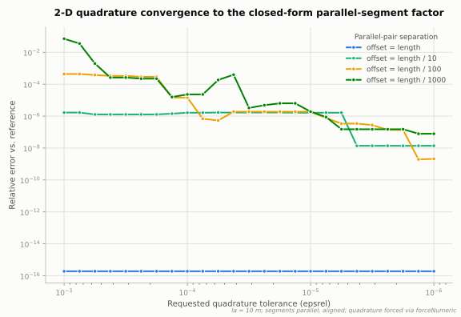
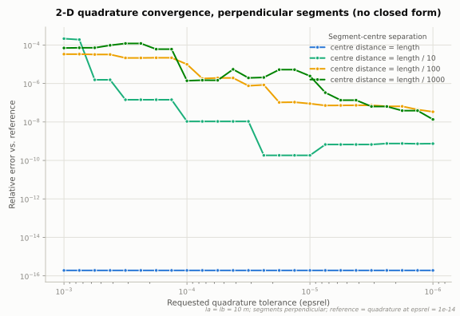

# 4. Mutual and self impedances

[Theory index](../theory.md) · previous: [§3 Potentials](s03-potentials.md) · next: [§4.5 Lightning channel](s04-5-lightning-channel.md)

> **Summary.** Integrating the two kernels of §3 over a pair of segments gives
> one entry of $Z_t$ and one of $Z_\ell$. Taking the propagation factor at
> the distance between midpoints leaves a purely geometric double integral,
> the geometry factor $g(a,b)$, which is computed once per structure. The self
> terms add the conductor's internal impedance and, where present, a coating.

Let segment *a* have endpoints $A_1A_2$, length $l_a$, and segment *b* endpoints
$B_1B_2$, length $l_b$, both in the same medium. $R_{ab}$ is the distance between
the integration points on the two axes (or axis-to-surface for self terms).

**Transversal.** Segment *b* leaks $I_t/l_b$ per metre. By §3 its potential at
a point of *a* is $\int_b (I_t/l_b)\,e^{-\gamma R}/(4\pi W R)\,d\ell_b$. The
model needs one number per segment, so this potential is averaged over the
length of *a* (a second integral, divided by $l_a$). Dividing by $I_t$:

$$Z_t(a,b) = \frac{1}{4\pi l_a l_b (\sigma + j\omega\varepsilon)} \iint \frac{\exp(-\gamma R_{ab})}{R_{ab}} \, d\ell_a \, d\ell_b$$

**Longitudinal.** Segment *b* carries $I_\ell$ along its axis and produces the
vector potential $\mathbf{A}$ of §3. The induced field $-j\omega\mathbf{A}$,
projected on the axis of *a* and integrated along it, is the voltage that *b*
induces along *a*. Per unit current:

$$Z_\ell(a,b) = \frac{j\omega\mu}{4\pi} \iint \frac{\exp(-\gamma R_{ab})}{R_{ab}} \, (d\ell_a \cdot d\ell_b)$$

For straight segments $d\ell_a \cdot d\ell_b = \cos \theta_{ab} \, d\ell_a \, d\ell_b$ with $\theta_{ab}$ the
(constant) angle between the segment directions.

Compare the two prefactors. $Z_t$ carries $1/W$: it falls with frequency in a
dielectric (a capacitive coupling) and is flat in a conductor (a resistive
one). $Z_\ell$ carries $j\omega\mu$ (an inductive coupling) and vanishes for
perpendicular segments. Both share the same kernel, which is what the next
section exploits.

## 4.1 Geometry-factor separation

Evaluating the complex double integral at every frequency is expensive. TUPÃ
uses the separation introduced in [3]: write $R_{ab} = \bar{R}_{ab} + \Delta R$, where $\bar{R}_{ab}$
is the distance between segment midpoints. When the propagation factor varies
little over the segments ($|\gamma| \cdot \Delta R \ll 1$), it can be pulled out of the integral
at the mean distance:

$$Z_t(a,b) \approx \frac{\exp(-\gamma\bar{R}_{ab})}{4\pi l_a l_b (\sigma + j\omega\varepsilon)} \cdot g(a,b)$$
$$Z_\ell(a,b) \approx \frac{j\omega\mu \exp(-\gamma\bar{R}_{ab})}{4\pi} \cdot \cos \theta_{ab} \cdot g(a,b)$$

with the **geometry factor**, a purely real, frequency-independent quantity:

$$g(a,b) = \iint \frac{d\ell_a \, d\ell_b}{R_{ab}}$$

The matrices of geometry factors $G$, mean distances $\bar{R}$, direction cosines
$\cos \theta$, and inverse length products $1/(l_a l_b)$ are computed **once** per
geometry; the frequency loop then only evaluates medium constants and
propagation factors. This is the decisive optimisation over the plain HEM
(where the full integrals are redone per frequency, cf. [5]) and bounds the
segment length: the approximation requires segments short compared to the
wavelength in the medium (in practice $\lesssim \lambda/10$, a few metres for soil at 1 MHz).
Lima et al. [11] locate where the separation starts to fail for their
20 × 20 m and 40 × 40 m grids in 1000 Ω·m soil: mHEM and full HEM agree
below ~4 MHz, then diverge steeply, which they attribute to the
non-uniformity of $\exp(-\gamma R)$ over the segment pair. TUPÃ's
reproduction of those curves shows the same onset
([validation/lima-fig7.md](../validation/lima-fig7.md)).

The same separation was published independently by Lima et al. [11] as the
**modified HEM (mHEM)**, with error analysis and validation against the full
HEM on grounding grids; it is the default integration mode of the open-source
TAGS and PRTL-mHEM codes (references.md). Their published results are an
external validation of this optimisation.

Two neighbouring results from the same group bracket this choice. sHEM [59]
goes one step further and truncates $\exp(-\gamma r)/r$ to its two-term
MacLaurin series $1/r - \gamma$, which makes the double integrals fully
closed-form (no numerical integration at all, up to ~2000× faster than the
plain HEM) — but its error grows above ~100 kHz in high-resistivity soils,
exactly where the $\exp(-\gamma\bar R)$ factor retained here stays exact.
And Moura's thesis [58] applies this same mean-distance separation to
nonuniform *overhead* spans (catenaries, river crossings), evidence that the
approximation carries over from buried electrodes to the line conductors
TUPÃ models in air.

**Segmentation in practice.** Two families of rules coexist in the
literature: thin-wire-driven (segment length $\gtrsim 10\, r_0$, so the
thin-wire approximation holds — the classic HEM prescription [5]) and
wavelength-driven ($\lesssim \lambda/10$ at the highest frequency of
interest, as above). Schroeder, Moura & Machado [19] show parametrically
that, for tower-footing studies, much coarser meshes remain acceptable:
segments up to $\sim 1000\, r_0$ keep GPR peaks within 10 % and insulator
overvoltage peaks within 5 % of a fine-mesh reference, with speedups above
30×, because the outputs of interest are integral quantities insensitive to
the fine structure of the current distribution. Segment length is therefore
an accuracy/cost knob bounded below by the thin-wire condition and above by
$\lambda/10$; the project default stays $\lambda/10$, with coarsening per
[19] as a documented option for large studies (`numerics.maxSegmentLength`, a per-study
target: an element gets max(`segments`, ⌈length/target⌉) segments, so elements
that omit `segments` follow the target alone, coarse or fine — ADR 0024 §3). The error of coarsening has
a known sign: Silva's segmentation study for the pulse basis [49, §5.3]
(10 $r_0$ segments as the converged reference) finds that coarser
discretisations systematically *underestimate* $|Z(\omega)|$ and GPR — a
candidate cause of the mostly negative mid-band knee error in
[validation/silva2025-fig3.md](../validation/silva2025-fig3.md).

## 4.2 Evaluating the geometry factor

- **Single-integral (mHEM) form** — the default quadrature
  ([ADR 0024](../adr/0024-phase10-numerics.md) §1), with the parallel closed
  form as fast path. The inner integral over a
  straight segment $b$ has a closed form: for a field point $p$ on segment
  $a$, with $r_1, r_2$ the distances from $p$ to the two ends of $b$,

  $$\int_0^{l_b} \frac{d\ell_b}{R} = \ln\left(\frac{r_1 + r_2 + l_b}{r_1 + r_2 - l_b}\right)$$

  (constant-$R$ sum defines prolate-spheroidal coordinates around $b$), so

  $$g(a,b) = \int_0^{l_a} \ln\left(\frac{r_1 + r_2 + l_b}{r_1 + r_2 - l_b}\right) d\ell_a$$

  — a 1-D adaptive quadrature of a smooth integrand [11]. Cheaper and
  better-conditioned than the double quadrature, especially for close
  segments: 8× faster on 120 random non-parallel segments (14 400 pairs),
  agreeing with the 2-D path to 7.9e-8. The implementation takes the
  tolerance `epsrel` directly (`epsabs = 0`; the 2-D path scales it by the
  shorter segment), writes $r_1 + r_2 - l_b$ as
  $\rho^2\left[(r_1 + s)^{-1} + (r_2 + l_b - s)^{-1}\right]$ for a field point
  alongside $b$ (axial coordinate $s$, distance $\rho$ to the axis) to avoid
  cancellation, and clamps the logarithm's argument where a touching
  end point makes the integrand $+\infty$ on a single point (an integrable
  singularity; a T junction is resolved to 2e-7 by the bisection).
- **General position, 2-D**: adaptive 2-D quadrature (nested Gauss–Kronrod
  7/15) of $1/R_{ab}$ over both segments. The integrand is smooth unless
  segments touch. Kept as the test oracle for the single-integral form and
  selectable (`numerics.kernel: "double"`, CLI `--kernel double`).
- **Parallel segments** and **orthogonal segments**: closed-form expressions
  exist (logarithms and arctangents of the corner distances); see [3, annex]
  for the derivation. Portela's *Campos e Ondas* problem collection [32]
  works the same parallel and orthogonal configurations (and the buried
  conductor with its image) from first principles — the course-text ancestry
  of these formulas. Used both as fast paths and as quadrature test oracles.
  The geometry factor does not depend on either segment's orientation, so
  an implementation reverses one segment of an opposite-direction pair and
  needs only the same-direction form. The closed form for
  opposite-direction pairs of unequal length printed in earlier codes is
  wrong and is not used.

  

  The figure sweeps the 2-D quadrature's requested relative tolerance
  (`epsrel`; `setQuadEpsRel`/`getQuadEpsRel`, 8 points per decade from
  $10^{-3}$ down to $10^{-6}$, the library's default) against the
  closed-form `parallelGeometryFactor` as an independent oracle, for
  parallel 10 m segments at four separations. Looser tolerances only
  visibly degrade accuracy for close pairs — the far pair (offset = length)
  is already accurate to machine precision across the whole range — and
  each closer pair's error trends gradually and somewhat noisily downward
  as `epsrel` tightens: offset = length/1000 goes from ~7 % relative
  error at `epsrel = 1e-3` down to ~$8\times10^{-8}$ at `epsrel = 1e-6`,
  with small ups and downs on the way, as expected of an adaptive integrator
  that honours a requested tolerance. This is why the closed form is the
  default path for parallel segments and not only a speed optimisation: at
  the tightest practical tolerance the closest pairs still carry
  ~$10^{-7}$–$10^{-8}$ relative error, where the closed form is exact. See the
  tolerance-sweep test in `fortran/test/test_geometry.f90` for the
  assertions this figure is drawn from.

  

  Perpendicular segments take the same quadrature path as the general
  position case; the closed form that [3, annex] gives for them is not used.
  With no closed form to check against, the
  oracle for this figure is instead the same quadrature at a very tight
  `epsrel = 1e-14`, swept over the same $10^{-3}$–$10^{-6}$ `epsrel` range
  as above, and the separation is the distance between the two segments'
  midpoints rather than a perpendicular offset. The qualitative
  picture matches the parallel case — the far pair is accurate immediately,
  closer pairs need progressively tighter `epsrel` and converge gradually
  rather than at one sharp threshold.
- **Coincident (self) factor**: for a segment of length $l$ and radius $r_0$,
  integrating axis-to-surface:

  $$g_{\text{self}} = 2 \left[ l \ln\left(\frac{l + \sqrt{l^2 + r_0^2}}{r_0}\right) - \sqrt{l^2 + r_0^2} + r_0 \right]$$

  Note $\ln\left(\frac{l+h}{h-l}\right) = 2 \ln\left(\frac{l+h}{r_0}\right)$ for $h = \sqrt{l^2+r_0^2}$, which explains
  the equivalent forms found in the literature. The identical expression is
  used by the open-source TAGS implementation (`self_integral`), an
  independent confirmation of this formula. Earlier TUPÃ codes used a different
  expression, which is not correct for $l \neq 1$ m; it should not be
  reused.

  For $l \gg r_0$ it tends to $2l\,[\ln(2l/r_0) - 1]$, which gives the
  familiar $\frac{\mu_0}{2\pi}\,l\,[\ln(2l/r_0) - 1]$ for the external
  inductance of a straight wire.

### Check yourself

- Two segments far apart ($\bar R \gg l_a, l_b$): show that
  $g \to l_a l_b/\bar R$, so $Z_t$ becomes the point-source potential of §3
  and $Z_\ell$ the mutual inductance of two current elements.
- Swap $a$ and $b$ in every formula of this section. Nothing changes: both
  matrices are symmetric (reciprocity), which the test suite checks.
- The [worked example](worked-example.md) evaluates $g_{\text{self}}$ and a
  collinear $g$ by hand.

## 4.3 Self impedances

The self (diagonal) terms combine three effects:

$$Z_\ell(a,a) = Z_{\text{int}} + Z_{\text{ext}} + Z_{\text{interface}}$$
$$Z_t(a,a) = Z_{t,\text{ext}} + Z_{t,\text{interface}}$$

- $Z_{\text{ext}}$ uses the machinery of §4.1 with $g_{\text{self}}$ and $\bar{R} = r_0$ (field point
  on the conductor surface); $Z_{t,\text{ext}} = \frac{\exp(-\gamma r_0) g_{\text{self}}}{4\pi l^2 (\sigma+j\omega\varepsilon)}$.
- $Z_{\text{interface}}$ is the image contribution (§5).
- $Z_{\text{int}}$ is the **internal impedance** (skin effect). For a solid cylindrical
  conductor of radius $r_0$, conductivity $\sigma_c$, permeability $\mu_c$:

  $$z_{\text{int}} = \frac{\sqrt{j\omega\mu_c/\sigma_c}}{2\pi r_0} \cdot \frac{I_0(\rho)}{I_1(\rho)}, \quad \rho = r_0 \sqrt{j\omega\mu_c \sigma_c}$$
  $$Z_{\text{int}} = z_{\text{int}} \cdot l$$

  with $I_0, I_1$ modified Bessel functions. For **tubular conductors**
  (inner radius $r_i$, current returning outside the tube) the Schelkunoff
  surface-impedance expression applies [40], with
  $\rho_0 = r_0\sqrt{j\omega\mu_c\sigma_c}$, $\rho_i = r_i\sqrt{j\omega\mu_c\sigma_c}$:

  $$z_{\text{int}} = \frac{\sqrt{j\omega\mu_c/\sigma_c}}{2\pi r_0} \cdot
  \frac{I_0(\rho_0)K_1(\rho_i) + K_0(\rho_0)I_1(\rho_i)}
       {I_1(\rho_0)K_1(\rho_i) - K_1(\rho_0)I_1(\rho_i)}$$

  which reduces to the solid formula as $r_i \to 0$. For large $|\rho|$ the
  ratio $I_0/I_1$ tends to 1 and the unscaled Bessel functions overflow, so
  an implementation needs scaled functions or an asymptotic branch; the
  Fortran reference takes $I_0/I_1 = 1$ above $|\rho| = 500$, where the
  neglected $1/(2|\rho|)$ correction is about $10^{-3}$
  ([ADR 0031](../adr/0031-remove-slatec-native-bessel.md)).

**Other cross-sections.** A segment's radius plays two parts: it is the
surface radius of the thin-wire kernel (the external part) and it enters the
skin-effect formula (the internal part). For a section that is not a round
homogeneous wire (a tube, a strip, an angle, a stranded or steel-cored
conductor) the two must be separated
([ADR 0030](../adr/0030-cross-section-internal-impedance.md)):

- the kernel uses an **equivalent radius** $r_{eq}$, the radius of the round
  wire with the same external field in the perfect-conductor limit (the
  logarithmic capacity of the section: $w/4$ for a thin strip of width $w$,
  $0.59\,a$ for a square of side $a$, the outer radius for a tube);
- the internal impedance is *defined relative to that radius*,

  $$z_{\text{int}}(\omega) = z_{\text{total}}(\omega) - j\omega\frac{\mu_0}{2\pi}\ln\frac{R_b}{r_{eq}},$$

  where $z_{\text{total}}$ is the per-metre impedance of the section inside a
  coaxial return of radius $R_b$. With this definition the internal and
  external parts add up to the true total, the circle recovers the Bessel
  formula above, and edge crowding sits in the resistance of
  $z_{\text{int}}$.

A study declares such sections as `crossSections` entries. The
Laplace-transform path of §8 evaluates $z_{\text{int}}$ at complex frequency,
which a table of $R(f)$, $X(f)$ cannot provide. An entry is therefore either
such a table (harmonic studies only) or a pole–residue fit,
$z_{\text{int}}(s) = d + e\,s + \sum_k c_k/(s - a_k)$, valid at any $s$. A
tubular conductor (a pipe, a steel pole) is one such entry, a fit of the
Schelkunoff formula above. A magnetic steel is linear with a constant
$\mu_r$ per entry; saturation is outside the model.

**Lumped elements in a segment.** A series R-L-C written in a `line` segment
(`lumped`) is added to that segment's internal impedance. The segment keeps
its electromagnetic coupling, unlike the `branch` of §6, which has none.

**Coated conductors.** A conductor may be surrounded by a thin coaxial layer
of another medium: the insulation of a wire, the concrete around a
reinforcing bar or foundation cage, a semiconducting or ground-enhancing
compound. The treatment is Sunde's insulated buried wire [41]. A layer of
outer radius $r_c$ and medium $(\sigma_c, \varepsilon_c)$ has a radial
admittance per unit length
$y_c = 2\pi(\sigma_c + s\varepsilon_c)/\ln(r_c/r_0)$, the coaxial-capacitor
formula with $s\varepsilon \to \sigma_c + s\varepsilon_c$. It sits in
**series** with the leakage path (JSON field `coating`). For a segment of
length $l$ the leakage
current $I_t$ crosses the layer before reaching the medium, so the mean
potential of the conductor surface exceeds that of the layer's outer surface
by $I_t/(y_c l)$:

$$Z_t(a,a) = \frac{c_E\,(e^{-\gamma r_c} g_{\text{self}}(l, r_c) \pm e^{-\gamma d_i} g_i)}{l^2}
 + \frac{\ln(r_c/r_0)}{2\pi (\sigma_c + s\varepsilon_c)\, l}.$$

The external self term is evaluated at $r_c$, where the leakage emerges;
$Z_\ell$ keeps $r_0$ (the layer is non-magnetic and carries no longitudinal
current); the mutual terms are unchanged, which is the thin-layer
assumption ($r_c \ll l$ and $r_c \ll$ the distance to other segments; a
warning is issued above $r_c = l/4$). The layer medium is any material, so
$s = j\omega$ or the NLT's $c + j\omega$ both apply. Checks in
`test_coating`: a layer of the soil's own medium reproduces the bare rod
(to 1.7 % with 15 segments); a conductive layer adds the shell resistance
$\ln(r_c/r_0)/(2\pi\sigma_c L)$ to the bare rod of radius $r_c$; an
insulating layer makes the rod a capacitor $2\pi\varepsilon_c L/\ln(r_c/r_0)$.
A pad or pile footing of 0.5–1.5 m radius violates the thin-layer assumption
and needs a finite-volume treatment, which the model does not have. An
earlier treatment of insulated cables, which dropped the soil conduction
path, is not used.

## 4.4 Catenary spans

Curved conductors enter the model as chains of straight segments, so every
formula above applies to them unchanged. An overhead span hanging between
nodes $\mathbf{P}_1$ and $\mathbf{P}_2$ takes the shape of a catenary. For a
midspan sag $d$ on a span $L$, a parabola through the same end points and
lowest point differs from it by terms of relative order $(d/L)^2$, i.e.
millimetres on a typical 300 m span with a few metres of sag. The earlier
code [3] therefore uses the parabola, and so does the
`catenary` element ([ADR 0023](../adr/0023-legacy-case-import.md)). With
$n$ segments, chain node $k$ sits at

$$\mathbf{p}_k = \mathbf{P}_1 + s_k\,(\mathbf{P}_2 - \mathbf{P}_1) - 4\,d\,s_k(1 - s_k)\,\hat{\mathbf{z}}, \qquad s_k = k/n,$$

which spaces the nodes evenly along the chord's horizontal projection and
drops the midpoint by exactly $d$ ($d < 0$ bows upward). Taking the height of every
internal node from $\mathbf{P}_1$ alone gives the same curve only when both
ends are at the same height. The chord form above agrees with it there and
stays continuous when the heights differ. A span must stay in its end
nodes' half-space (§5): implementations reject a profile that crosses
$z = 0$. The §4.1 segment-length bounds apply along the arc. Moura's
thesis [58] models non-uniform overhead spans this way and supports
carrying the mean-distance approximation over to them.

The sag matters most for induced voltages (§4.6). Stracqualursi et al. [96]
solve the Agrawal equations on a nonuniform line with parabolic sag. Against
the same line at a uniform average height, sag changes direct-strike surges by
under 1 % but induced voltages by more than 20 % (27–35 % on the phases of
their realistic line). The uniform line underestimates the peak, and so does a
staircase of constant-height sections. In the HEM a sagged span is just this
chain of segments, so the incident field reaches each segment at its own
height without any further approximation.

---

Next: [§4.5 The lightning-channel element](s04-5-lightning-channel.md)
