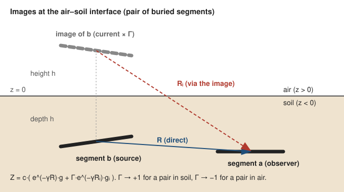

# 5. The air–soil interface: image method

[Theory index](../theory.md) · previous: [§4.6 Induced voltages](s04-6-induced-voltages.md) · next: [§6 Nodal system](s06-nodal-system.md)

> **Summary.** The formulas of §4 hold in an unbounded medium. The flat
> boundary between air and soil is handled by adding, for every segment, a
> mirror-image segment whose strength is the original's times a reflection
> coefficient $\Gamma$. For buried conductors $\Gamma \to +1$, for conductors
> in air $\Gamma \to -1$, and in general $\Gamma$ depends on frequency.
> Segments in different media are uncoupled unless the transmitted-field
> option of §5.1 is switched on.

Two half-spaces (air: $\sigma \approx 0, \varepsilon_0$; soil: $\sigma_s, \varepsilon_s$) meet at $z = 0$. The
boundary condition is represented by **images**: each segment has a mirror
image reflected through $z = 0$, and every impedance term gains an image
contribution evaluated with the image geometry factor $g_i$, image mean distance
$\bar{R}_i$, and the propagation constant of the medium containing the *real*
segments:

$$Z_t(a,b) = \frac{c_E}{l_a \, l_b} \left( \exp(-\gamma\bar{R}) g + \Gamma \exp(-\gamma\bar{R}_i) g_i \right)$$
$$Z_\ell(a,b) = c_M \, \cos \theta \, \exp(-\gamma\bar{R}) g + c_M \, \cos \theta_i \, \Gamma \exp(-\gamma\bar{R}_i) g_i$$

where

$$c_E = \frac{1}{4\pi(\sigma+j\omega\varepsilon)}, \qquad c_M = \frac{j\omega\mu}{4\pi}$$

and $\theta_i$ is the angle with the image direction (the image of a segment
reverses the sign of the $z$ component of its direction vector).

## 5.0 Where the reflection coefficient comes from

Put a point source that injects current $I$ in medium 1 (immittance $W_1$), at
distance $h$ from the plane boundary with medium 2 ($W_2$). Neglect
retardation for a moment (the quasi-static step). Try a potential made of the
source plus an image of strength $\Gamma I$ at the mirror point for medium 1,
and a single source of strength $\tau I$ at the original point for medium 2:

$$\psi_1 = \frac{I}{4\pi W_1}\left(\frac{1}{R} + \frac{\Gamma}{R_i}\right), \qquad
\psi_2 = \frac{\tau\,I}{4\pi W_1}\,\frac{1}{R} .$$

On the boundary $R = R_i$. Two conditions must hold there: the potential is
continuous, and so is the normal component of the total current density
$W\,\partial\psi/\partial n$. They give $1 + \Gamma = \tau$ and
$W_1(1 - \Gamma) = W_2\,\tau$, hence

$$\Gamma = \frac{W_1 - W_2}{W_1 + W_2}, \qquad \tau = \frac{2W_1}{W_1 + W_2} .$$

This is the image of electrostatics for two dielectrics with
$\varepsilon \to W/j\omega$. The retardation factor
$e^{-\gamma\bar R_i}$ of the source medium is then attached to the image term,
which is the approximation that makes the method *quasi-static* at the
interface.

The two limits give the sign rules:

| Configuration | $\Gamma$ | Picture |
| --- | --- | --- |
| Both segments in **soil** ($W_1 = W_s$, $W_2 = j\omega\varepsilon_0$, $\lvert W_s\rvert \gg \omega\varepsilon_0$) | $\to +1$ | the air does not conduct, no current crosses the surface: the image leaks current of the *same* sign |
| Both segments in **air** ($W_1 = j\omega\varepsilon_0$, $W_2 = W_s$) | $\to -1$ | the soil is nearly an equipotential: the image has the *opposite* sign |
| Segments in different media | — | coupling set to zero by default; transmitted term $\tau$ opt-in (§5.1) |

The same $\Gamma$ multiplies the image terms of $Z_t$ and of $Z_\ell$. For
$Z_\ell$ the factor $\cos\theta_i$ takes care of the direction: with
$\Gamma = -1$ above a conducting soil, the image of a horizontal current
flows the opposite way and the image of a vertical current flows the same
way, as for a perfect conductor.

In terms of the stored constants,
$\Gamma = (c_E^{\text{other}} - c_E^{\text{own}})/(c_E^{\text{other}} + c_E^{\text{own}})$
for a segment in either medium, so the Laplace-domain path of §8
($s = c + j\omega$) uses it unchanged. The ideal values $\pm 1$ are selectable
(`numerics.imageModel: "ideal"`, [ADR 0024](../adr/0024-phase10-numerics.md) §2).

## 5.0.1 How this compares with other codes

For segments buried in soil, TAGS and PRTL-mHEM use

$$\Gamma_t(\omega) = \frac{W_s - j\omega\varepsilon_0}{W_s + j\omega\varepsilon_0}, \qquad \Gamma_\ell = 1$$

as *available* coefficients. PRTL-mHEM applies $\Gamma_t$ to the image terms
of both $Z_t$ and $Z_\ell$, and TAGS keeps the two as independent parameters.
TUPÃ applies the single $\Gamma$ to both, as PRTL-mHEM does and as
the author's earlier code [3] does. For equal permeabilities it can be written
$(k_1^2 - k_2^2)/(k_1^2 + k_2^2)$ with $k$ the wavenumbers of the two media. It is
the "modified image theory" kernel that Grcev introduced [61, 62] and later
classified [56], and the reflection factor of the antenna-model literature
for a source in air [74, ch. 9].

## 5.0.2 How much it matters, and where it stops

The ideal sign rules are the $|W_s| \gg \omega\varepsilon_0$ limit. They
degrade for high-resistivity soils toward the MHz range, where $\Gamma$
acquires magnitude below 1 and a phase. The difference grows as $f^2$: for a
10 m conductor 0.5 m deep in 0.01 S/m, $\varepsilon_r = 10$ soil the input
voltage differs from the ideal-image one by 2.5e-8 at 10 Hz, 2.3e-4 at
100 kHz and 1.8e-3 at 1 MHz. Against published curves it moves the mean error
by under 2 points
([validation/phase10-image-model.md](../validation/phase10-image-model.md)),
and it matches TAGS' $\Gamma_t(\omega)$ to 0.04 % below 1 MHz
([validation/tags-xval.md](../validation/tags-xval.md)).

Even with $\Gamma(\omega)$, the image treatment is quasi-static and the HEM
family is usually quoted as accurate from DC up to a few MHz [19, 20]. That
figure stands in for electrical size, not for an absolute frequency: the
quasi-static premise needs system dimensions under ~λ/10 in the soil at the
highest frequency of interest [56] (§10.1). A single 2 m vertical rod in
5400 Ω·m, $\varepsilon_r = 10$ soil (Poljak & Doric [35]) stays within
±10 % of the antenna-theory reference up to 100 MHz
([validation/poljak-fig4.md](../validation/poljak-fig4.md)). That result is
*not* evidence for the ideal-image limit in general: at 100 MHz in that
soil $\sigma/\omega\varepsilon \approx 0.003$, so
$\Gamma \approx (\varepsilon_r - 1)/(\varepsilon_r + 1) \approx 0.82$
instead of the $+1$ of the ideal limit, which makes it the natural
regression case for $\Gamma(\omega)$. Kuhar, Arnautovski-Toševa & Grčev [20]
push the ceiling by replacing the quasi-static images with **complex images**
(the finitely conducting earth replaced by a perfect conductor at a complex
depth), recovering agreement with full-wave NEC-4 solutions at higher
frequencies. Lightning spectra rarely require this.

For the **self** terms the "mutual with the own image" appears with distance
$\bar{R}_i = 2h$ (twice the depth or height of the segment centre). At DC,
combining this image term with the own term at $r_0$ reproduces the classic
"equivalent radius" $\sqrt{2hr_0}$ construction of [32].

A separate limitation is the *single* interface: this section models one
air–soil boundary with uniform soil below. Horizontally stratified soils
replace the single image by layered-earth Green's functions, made affordable
by quasi-static complex images (matrix-pencil fitted), as in the multilayer
hybrid of Li, Chen & Wang [33]; Michalski & Mosig [135] review the general
formulation. TUPÃ assumes a uniform half-space (§10.1).

## 5.1 Cross-medium coupling (opt-in transmitted-field model)

By default a segment in air and a segment in soil are uncoupled: the
coupling is second-order for most grounding problems, and the earlier
codes [3] neglect it. `numerics.crossMedium: "transmission"` (default `"none"`)
couples them through the field that crosses the interface
([ADR 0029](../adr/0029-cross-medium-coupling.md)). The transmitted term is
the $\tau$ of §5.0: for a point source in medium 1 observed in medium 2
(Salari [66] App. B reaches the same $\tau$ as the quasi-static limit of the
Fresnel coefficients, and adds the warning that the simplification needs
case-by-case checking):

$$\phi_2 = \frac{q}{2\pi\,(W_1 + W_2)}\,\frac{1}{R}, \qquad W = \sigma + j\omega\varepsilon .$$

There is **no image term** in the other medium. The antenna-model literature
writes the same factor as $2W_2/(W_1 + W_2)$ against the *observation*
medium's constant [74, ch. 9]; both forms give
$c_E\,\tau = 1/(2\pi(W_1 + W_2))$. Carrying it through the
segment integrals of §4.1 and attaching retardation, the mixed-pair entries are

$$Z_t(a,b) = \frac{c_E^{\times}}{l_a\,l_b}\, e^{-\gamma_a R_a - \gamma_s R_s}\, g,
\qquad Z_\ell(a,b) = c_M^{\times}\,\cos\theta\; e^{-\gamma_a R_a - \gamma_s R_s}\, g,$$

with $c_E^{\times} = 1/(2\pi(W_a + W_s)) = 2\,c_E^{a} c_E^{s}/(c_E^{a} + c_E^{s})$
(symmetric in the two media, so the mixed block stays reciprocal, §9 item 4),
$c_M^{\times}$ the mean of the two $c_M$ (the model assumes equal permeabilities),
$g$ the ordinary direct geometry factor of the pair, and $R = R_a + R_s$ the
midpoint distance split at the point where the straight midpoint-to-midpoint
ray crosses $z = 0$. $Z_\ell$ has no image parcel either: with equal $\mu$ the
vector potential is continuous across the interface to the quasi-static level,
so only its reflection (a higher-order effect) is dropped.

Checks built into the test suite ([ADR 0029](../adr/0029-cross-medium-coupling.md)):
for identical media the mixed kernel equals the homogeneous direct term
and $\Gamma = 0$; the scalar potential is continuous across $z = 0$ with the
coupling on and visibly discontinuous with it off; and the same
transmitted term is applied to the observation potentials of §3.1, so GPR,
touch and step voltages feel air-side sources (the lightning channel
included). **Limits.** The retardation factor is the
straight-ray heuristic, not a Sommerfeld solution; the model is a
low-frequency one and the neglected lateral-wave terms grow with frequency
(§10.1). On `rod_air` the input voltage moves by 3.6e-6 at 10 Hz, 3.6e-4 at
1 kHz, 3.1e-2 at 100 kHz and 5.7e-2 at 1 MHz; for the tower–channel–rod
case (`channel_tower_cross`) the tower-top voltage moves by 0.2 % at
10 kHz and 9.5 % at 1 MHz.
The model has analytic limits and continuity checks behind it but no
published curve yet, which is why it is not the default. Anything beyond it
is Sommerfeld territory (§10.1). The antenna-theory reflection/transmission
kernel of Poljak & Doric [35] is a published analogue, and the moment-method
treatment of wires crossing a lossy interface by Burke & Miller [134] is the
full-wave reference.

## Check yourself

- Derive $\Gamma$ and $\tau$ from the two boundary conditions of §5.0.
- Evaluate $\Gamma$ for a buried segment in 1000 Ω·m, $\varepsilon_r = 10$
  soil at 100 Hz and at 10 MHz. At which frequency does $|1 - \Gamma|$ reach
  1 %?
- Set both media equal. $\Gamma = 0$, $\tau = 1$, and the cross-medium kernel
  of §5.1 must reduce to the homogeneous direct term. Verify it.
- The [worked example](worked-example.md) shows the image raising the
  resistance of a buried rod by 8 %. Would it raise or lower the capacitance
  to ground of a wire in air?
