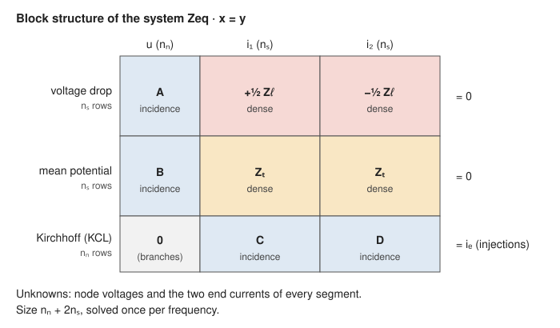

# 6. Nodal system

[Theory index](../theory.md) · previous: [§5 Image method](s05-interface.md) · next: [§7 Soil](s07-soil.md)

> **Summary.** Three statements per frequency close the model: the voltage
> difference between the ends of a segment equals the drop caused by all
> longitudinal currents; the mean voltage of a segment equals the potential
> caused by all leakage currents; and currents balance at every node. Stacked,
> they form one linear system in the node voltages and the segment end
> currents.

With $n_n$ nodes and $n_s$ segments, define the incidence matrices (all sparse,
entries 0 elsewhere):

- **A** ($n_s \times n_n$): row $j$ has $-1$ at column $n_1(j)$, $+1$ at $n_2(j)$;
- **B** ($n_s \times n_n$): row $j$ has $-\frac{1}{2}$ at both $n_1(j)$ and $n_2(j)$;
- **C** ($n_n \times n_s$): column $j$ has $+1$ at row $n_1(j)$;
- **D** ($n_n \times n_s$): column $j$ has $+1$ at row $n_2(j)$.

Three physical statements close the model ($\mathbf{u}$ = node voltages, $\mathbf{i}_1, \mathbf{i}_2$ = end
currents, both into the segment; $\mathbf{i}_e$ = external currents injected at nodes):

1. **Longitudinal voltage drop**: $u(n_1) - u(n_2) = Z_\ell \cdot I_\ell$.
   The difference of the node potentials at the two ends of segment $a$ is
   the line integral of the field along it, which §4 expresses as row $a$ of
   $Z_\ell$ times the mean currents of all segments. With
   $I_\ell = (i_1 - i_2)/2$:

   $$\mathbf{A} \mathbf{u} + \frac{1}{2} Z_\ell \mathbf{i}_1 - \frac{1}{2} Z_\ell \mathbf{i}_2 = 0$$

2. **Mean surface potential from leakage**: $\frac{u(n_1) + u(n_2)}{2} = Z_t \cdot I_t$.
   The average potential on the surface of segment $a$, approximated by the
   mean of its two node voltages, is row $a$ of $Z_t$ times the leakage
   currents of all segments. With $I_t = i_1 + i_2$:

   $$\mathbf{B} \mathbf{u} + Z_t \mathbf{i}_1 + Z_t \mathbf{i}_2 = 0$$

3. **KCL at each node** (currents leave the node into the segments):

   $$\mathbf{C} \mathbf{i}_1 + \mathbf{D} \mathbf{i}_2 = \mathbf{i}_e$$

Stacked as one linear system $Z_{\text{eq}} \mathbf{x} = \mathbf{y}$ of dimension $n_n + 2n_s$:

$$\begin{bmatrix}
\mathbf{A} & \frac{1}{2}Z_\ell & -\frac{1}{2}Z_\ell \\
\mathbf{B} & Z_t & Z_t \\
\mathbf{0} & \mathbf{C} & \mathbf{D}
\end{bmatrix}
\begin{bmatrix} \mathbf{u} \\ \mathbf{i}_1 \\ \mathbf{i}_2 \end{bmatrix} =
\begin{bmatrix} \mathbf{0} \\ \mathbf{0} \\ \mathbf{i}_e \end{bmatrix}$$

solved by dense LU (LAPACK `ZGESV`) once per frequency
([ADR 0003](../adr/0003-augmented-zeq-system.md)). The cost is
$\propto (n_n + 2n_s)^3$ per frequency and dominates a study; the geometry
factors are computed once.

**Reduced form.** Rows 1 and 2 give
$\mathbf{i}_1 - \mathbf{i}_2 = -2 Z_\ell^{-1}\mathbf{A}\mathbf{u}$ and
$\mathbf{i}_1 + \mathbf{i}_2 = -Z_t^{-1}\mathbf{B}\mathbf{u}$; substituting
into the KCL row eliminates $\mathbf{i}_1, \mathbf{i}_2$ and yields the
nodal admittance relation used when only $\mathbf{u}$ is needed and
$n_n \ll n_s$:

$$\mathbf{u} = Z_g \mathbf{i}_e, \quad Z_g = \left[ (\mathbf{D}-\mathbf{C}) Z_\ell^{-1} \mathbf{A} - \frac{1}{2} (\mathbf{C}+\mathbf{D}) Z_t^{-1} \mathbf{B} \right]^{-1} = \left[ \mathbf{A}^T Z_\ell^{-1} \mathbf{A} + \mathbf{B}^T Z_t^{-1} \mathbf{B} \right]^{-1}$$
$$\mathbf{i}_1 = -\left( Z_\ell^{-1}\mathbf{A} + \frac{1}{2} Z_t^{-1}\mathbf{B} \right) \mathbf{u}$$
$$\mathbf{i}_2 = \left( Z_\ell^{-1}\mathbf{A} - \frac{1}{2} Z_t^{-1}\mathbf{B} \right) \mathbf{u}$$

The second form of $Z_g$ follows from $\mathbf{D}-\mathbf{C} = \mathbf{A}^T$
and $-\frac{1}{2}(\mathbf{C}+\mathbf{D}) = \mathbf{B}^T$; it is a
congruence, so $Z_g$ is symmetric whenever $Z_\ell$ and $Z_t$ are
(reciprocity). For a single segment it reduces to the expected
π-equivalent: series admittance $1/Z_\ell$ between the two nodes plus
$(u_1+u_2)/(4Z_t)$ leaking at each. The forms above reproduce the augmented
solve to round-off on random test systems.

This trades one $(n_n+2n_s)^2$ solve for two $n_s \times n_s$ solves plus a $n_n \times n_n$ solve
(cf. [1] eqs. 50–56, in its own $\mathbf{i}_2$ convention — see the sign
caveat below — and [4]). Both forms must give identical results — a useful
consistency test. A third, equivalent layout is the symmetric block system in
the unknowns $(\mathbf{u}, I_\ell, I_t)$ used by TAGS.

**Lumped circuit branches.** A series R-L-C `branch` between nodes $a$ and
$b$ ($b = 0$: remote earth, the ground plane of ideal images) adds no
unknowns ([ADR 0028](../adr/0028-induced-voltages-and-lumped-branch.md)). It
is one more current leaving the node in the KCL block, $Y(s)(u_a - u_b)$ at
$a$ and the opposite at $b$, with $Y = 1/(R + sL + 1/(sC))$ (written
$sC/(1 + sCR + s^2LC)$ when a capacitor is present). It is stamped into the
$\mathbf{u}$ columns of the KCL rows of $Z_{\text{eq}}$ after the
electromagnetic block is assembled, at $s = j\omega$ or $s = c + j\omega$
(§8), and touches no segment row. A branch therefore has no electromagnetic
coupling to any segment and no leakage current, by construction. A unit test
pins the DC behaviour: a 5 Ω resistor in series with a grounded rod, and a
50 Ω shunt in parallel with it, reproduce the closed forms to 1e-9. A
zero-impedance branch is refused.

An alternative is to treat the branch as an extra segment of the
$(\mathbf{i}_1, \mathbf{i}_2)$ system, with the lumped $Z$ on the $Z_\ell$
diagonal and zeroed $Z_t$ rows. That needs an argument that the system stays
nonsingular, which the nodal stamp avoids.

**Sources.** A current source is an entry of $\mathbf{i}_e$
([ADR 0010](../adr/0010-sources-as-current-injections.md)). A source between
two nodes is a pair of opposite entries (§4.5). An ideal voltage source is
obtained by superposition: the system is solved for a unit current at the
source node, and the current that produces the prescribed voltage follows by
linearity ([ADR 0016](../adr/0016-voltage-sources-by-superposition.md)).

**The quasi-stationary (DC) point.** At exactly $\omega = 0$ the system is
singular for conductors in air ($W = 0$, so $c_E$ is infinite). The DC limit
is therefore a true solve at a very low frequency (default 1 mHz,
`frequencies.dc`), where $\omega L \ll R$ and displacement currents vanish;
the relative error is of order $(\omega/\omega_c)^2$. Much below
$10^{-5}$ Hz the air-side conditioning degrades.

> **Sign caveat.** The literature differs in the direction assumed for $\mathbf{i}_2$
> (Portela [1] takes it *out* of the segment at node $n_2$, flipping signs in B,
> D and the $\mathbf{i}_2$ blocks). The table above is self-consistent with the
> both-into-segment convention of §2. Implementations must verify against the
> DC limit (§9), not against any single paper's sign table. Storing **D** with
> entries $-1$ and assembling the KCL block as
> $[\mathbf{0}\ \mathbf{C}\ -\mathbf{D}]$ has the same net effect as the
> table above; mixing the two bookkeeping styles is the trap.

## Check yourself

- Write $\mathbf{A}$, $\mathbf{B}$, $\mathbf{C}$, $\mathbf{D}$ for two
  segments in series (three nodes) and verify
  $\mathbf{D} - \mathbf{C} = \mathbf{A}^T$.
- Solve the one-segment system by hand for a current injected at node 1 and
  node 2 left open: this is the [worked example](worked-example.md).
- Show that $Z_g$ is symmetric when $Z_\ell$ and $Z_t$ are.
- Why can a `branch` connect a node to remote earth while a segment cannot?
