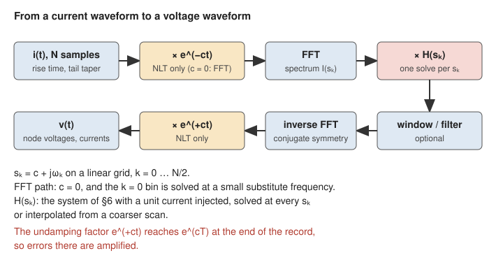

# 8. Transient (time-domain) response

[Theory index](../theory.md) · previous: [§7 Soil](s07-soil.md) · next: [§9 Validation anchors](s09-validation.md)

> **Summary.** The model is linear, so the response to any current waveform
> is the waveform's spectrum times a transfer function, transformed back to
> time. The transfer function comes from the system of §6 solved on a linear
> frequency grid. Two transforms are available: the plain FFT, and the
> Numerical Laplace Transform (NLT), which damps the signals to suppress
> wrap-around and is the better choice when the response does not die out
> within the record.

## 8.1 The route

1. Sample the excitation waveform (for example a Heidler or
   double-exponential lightning surge) and take its FFT.
2. Solve the frequency-domain system at the required frequencies and form the
   transfer function $H$ between the injected signal and each observed
   quantity.
3. Multiply and inverse-transform.

The schema of the `signal` block is in
[ADR 0015](../adr/0015-time-domain-signal-schema.md).

## 8.2 The frequency grid

A record of $N$ samples spaced $\Delta t$ lasts $T = N\Delta t$. Its discrete
spectrum has bins spaced $\Delta f = 1/T$ up to the Nyquist frequency
$f_{Nyq} = 1/(2\Delta t)$. Two rules follow.

- The record must be long enough for the response to end (or NLT must be
  used, §8.6): the discrete transform describes a *periodic* signal of period
  $T$, so whatever has not decayed by $T$ reappears at the start.
- $f_{Nyq}$ must cover the spectrum of the *response*, not only of the
  excitation. Portela [1] and [3] found 512–8192 frequencies up to 1 MHz
  sufficient for lightning impulses, but Grcev & Arnautovski-Toseva [56]
  needed 8 MHz (30 Ω·m soil) to 16 MHz (300 Ω·m) before the voltage of a 6 m
  rod under a subsequent-stroke pulse converged. The upper bound deserves a
  convergence check per study.

The one-sided spectrum (bins 0 to $N/2$) of the excitation is multiplied, bin
by bin, by the transfer function for a unit current, rebuilt to a full
spectrum by conjugate symmetry and inverse-transformed. The DC bin is solved
at a small nonzero substitute frequency (`freqZeroHz`), because the system is
singular at exactly $\omega = 0$ for conductors in air (§6,
[ADR 0019](../adr/0019-air-medium-hardcoded-vacuum.md)). The FFT is a small
in-repo double-precision radix-2 transform
([ADR 0014](../adr/0014-fft-implementation.md)).

The two sweep modes use different axes: a *harmonic* study uses a
log-spaced axis of real frequencies, while a *transient* needs the linear
grid above.

## 8.3 Excitation waveforms

| `waveform` | Law | Notes |
| --- | --- | --- |
| Heidler | $\dfrac{I_0}{\eta}\dfrac{(t/\tau_1)^n}{1 + (t/\tau_1)^n}e^{-t/\tau_2}$, sums allowed | zero slope at $t = 0$; the standard lightning current [37, 38, 39]; the two-term subsequent stroke is in §4.6.1 |
| Double exponential | $I_0\,(e^{-\beta t} - e^{-\alpha t})$ | laboratory impulse shapes; the Jones variant [65] replaces $e^{-\alpha t}$ by $e^{-(\alpha t)^2}$ for zero initial slope |
| `portela` | concave front, flat top, linear tail (below) | Portela's grounding studies [1, 67] |
| `sine` | $I\sin(2\pi f t + \varphi)$ for $t \ge 0$ | switched-on sinusoid |
| `step`, `branchNorton` | step; the Norton current of a charged capacitor behind a series R-L-C `branch` | impulse-generator studies ([marx_generator.md](../marx_generator.md)) |

Portela's surge is piecewise:

$$i(t) = I_{max}\,\frac{e^{\alpha t/t_1} - 1}{e^{\alpha} - 1} \quad (0 < t < t_1),
\qquad i = I_{max} \quad (t_1 \le t < t_2),$$

then a linear decay from $I_{max}$ at $t_2$ to zero at $t_3$. The front is
concave for $\alpha > 0$, as in first negative strokes, and convex for
$\alpha < 0$, as in subsequent strokes [67, Vol. II §8.1]; both signs are
accepted. As $\alpha \to 0$ the front becomes the linear ramp $t/t_1$ and the
quotient is $0/0$, so it is evaluated as
$\mathrm{expm1}(\alpha t/t_1)/\mathrm{expm1}(\alpha)$. The slope jumps at
$t_1$, $t_2$ and $t_3$ make the spectrum decay only as $1/\omega^2$, unlike
the smooth Heidler function, so truncation at the Nyquist bound rings more
visibly (§8.5).

**Rise time of a step-like source.** A hard step has content at every
frequency, and its band-limited reconstruction rings. `signal.riseTime`
convolves the sampled excitation with a causal triangular kernel of unit area
and base $2\,t_r$, which delays it by $t_r$ and turns a step into a smooth
ramp ([ADR 0032](../adr/0032-excitation-rise-time.md)). It is as much physics
as numerics: a spark gap does not close in zero time. A symmetric kernel does
not help, because it leaves a jump at $t = 0$.

## 8.4 The transfer function

**Per-bin solve** (`transferFunction: "full"`, the default): the system is
solved at every one of the $N/2 + 1$ bins.

**Scan-fed** (`"interpolated"`): $H$ is smooth, so it can be solved on the
study's own, much coarser `frequencies` axis and interpolated onto the bins.
The interpolation is a piecewise-cubic Hermite (pchip, Fritsch–Carlson
slopes) on $\mathrm{Re}\,H$ and $\mathrm{Im}\,H$ separately. The axis must
span $[f_{zero}, f_{Nyq}]$; an axis that would need extrapolation is refused.
On the 60 m `silva2025` electrode with a 128-point scan the result stays
within $1.7\times10^{-5}$ of peak of the per-bin solve at the injection node
and $2.7\times10^{-5}$ at the far end, at 12–15× less run time
([validation/phase9-transient-options.md](../validation/phase9-transient-options.md)).
A transfer function between distant points carries a delay $\tau$ and winds
its phase; when $\Delta f\,\tau \gtrsim 1/2$ between scan points the
interpolation fails, so long structures need a denser scan, and the per-bin
solve is the check. The scan-fed mode cannot be combined with NLT: a fit over
real frequencies is not the analytic continuation $H(c + j\omega)$.

**Several injections** (`signal.sources`): by linearity the response is
$\sum_k H_k(s)\,X_k(s)$, with $H_k$ the transfer function of a unit current at
source $k$, summed per output before a single inverse transform.

**Independent signals** (`signal.signals`,
[ADR 0026](../adr/0026-independent-transient-signals.md)): excitations that
are *not* summed; each gives its own response set. $H_k$ depends only on the
terminal (node, return node, quantity), not on the waveform, so it is solved
once per distinct terminal, and all terminals share one factorisation per
frequency. A list of waveforms on one node costs one solve.

## 8.5 Truncation: tapers, filters and windows

Three separate devices deal with the two ends of the record and of the band.

- **Tail taper.** The sampled excitation is tapered to zero over the final
  20 % of the record (an erfc ramp), so that the periodic extension has no
  jump.
- **Band-edge filter** (`antialiasStart`,
  [ADR 0021](../adr/0021-transient-antialias-filter.md)). Cutting the spectrum
  abruptly at $f_{Nyq}$ leaves Gibbs ringing in $v(t)$ whenever the response
  still has content there. A Tukey (raised-cosine) filter can multiply
  $H\cdot X$: with $x = f/f_{Nyq}$ and a start fraction $s_0 \in (0, 1]$,
  $w(x) = 1$ for $x \le s_0$ and
  $w(x) = \tfrac12[1 + \cos\frac{\pi(x - s_0)}{1 - s_0}]$ above. It is off by
  default, since it lowers fast-front peaks (a few percent for a 1.2 µs front
  at 1 MHz with $s_0 = 0.85$). Despite the field name it does not act on
  aliasing: it suppresses band-edge *truncation* ringing, while time-domain
  wrap-around is governed by the record length and, under NLT, by the
  damping.
- **Window** (`signal.window`). The falling half of a Hann window,
  $w(x) = \tfrac12[1 + \cos\pi x]$, in one of two placements. `"spectral"`
  multiplies the one-sided $H\cdot X$ product ($x = f/f_{Nyq}$); it is the
  data window of the NLT literature [17] and the $s_0 \to 0$ limit of the
  Tukey filter. `"time"` multiplies the sampled excitation ($x = t/t_{last}$).
  Filter and window are separate options and multiply when both are set.

## 8.6 The Numerical Laplace Transform

**The problem it solves.** The inverse FFT returns the periodic sum
$\sum_{m \ge 0} y(t + mT)$ of the true response $y$. If $y$ has not decayed
by $T$, the later copies fold onto the record (wrap-around, or time
aliasing). Slowly decaying responses, and responses that end at a nonzero
value, are the bad cases.

**The idea.** Damp everything by $e^{-ct}$ before transforming, and undo it
afterwards (Gómez & Uribe [17]; Moreno & Ramirez [136] review the method and
its two error sources, truncation and aliasing). The transform of $x(t)e^{-ct}$ at frequency
$\omega$ is the Laplace transform of $x$ at $s = c + j\omega$, so:

1. multiply the sampled excitation by $e^{-ct}$ and take its FFT, giving
   $X(s_k)$ with $s_k = c + j\omega_k$;
2. solve the system at the complex frequencies $s_k$;
3. inverse-transform $H(s_k)X(s_k)$, which gives the periodic sum of
   $y(t)e^{-ct}$;
4. multiply by $e^{+ct}$.

The result is $y(t) + \sum_{m \ge 1} y(t + mT)\,e^{-cmT}$: the wrapped copies
are attenuated by $e^{-cT}$ each. The plain FFT is the case $c = 0$. With the
usual choice $c = \ln(N^2)/T$ the attenuation is $1/N^2$ (as in TAGS, PRTL
and PRTL-mHEM); `nltDamping` overrides it. The bin $s_0 = c$ is regular, so
no DC substitute is needed.

**What the physics must provide.** Every frequency-dependent quantity has to
be evaluated at complex $s$ on the principal branch:
$W(s) = \sigma + s\varepsilon$ (constant medium),
$\sigma_0 + \Delta_i (s/\omega_0)^{\alpha}/\sin(\pi\alpha/2)$ (Lima–Portela,
§7.2),
$\sigma_0 + \sigma_0 h (s/\omega_0)^{\xi}/\cos(\pi\xi/2) + s\varepsilon_0\varepsilon_\infty$
(Alipio–Visacro, §7.3), $\gamma = \sqrt{s\mu W(s)}$, the image coefficient of
§5, and the internal impedance with $\rho = r_0\sqrt{s\mu\sigma}$ or a
pole–residue entry (§4.3). All reduce to the harmonic formulas on
$s = j\omega$ and satisfy $W(\bar s) = \overline{W(s)}$, so the
conjugate-symmetric reconstruction holds.

**The price.** Step 4 multiplies by a factor that grows to $e^{cT} = N^2$ at
the last sample. Any error present in the damped result (band truncation,
round-off, interpolation) is amplified by that factor, most at the end:

- plain NLT output is reliable over the early part of the record, the first
  half to about 80 % depending on the case
  ([validation/phase9-transient-options.md](../validation/phase9-transient-options.md));
- a spectral window acts on the *damped* spectrum, so it confines the growth
  to the last few samples, but it smooths fronts that span only a few samples
  differently than under the FFT;
- where the plain FFT is limited by wrap-around, NLT is 6–10× closer to a
  long-record reference over the first half of the record.

**Step-like sources.** A hard step (`step`, `branchNorton`) is the worst
case: the pre-ringing of its band-limited reconstruction wraps to the last
samples, exactly where the undamping is largest. Two remedies work together
([ADR 0032](../adr/0032-excitation-rise-time.md)): the rise time of §8.3,
which removes the source of the leakage, and a smaller damping,
$cT \approx 6$ instead of $\ln N^2$. The default assumes leakage near machine
precision; a smaller $c$ trades the end-of-record growth for a wrap-around
offset $\propto e^{-cT}$ times the late response. On the `marx_lab_2MV` case
the two together bring the error against a 4× longer record to
$\le 10^{-4}$ of peak over the first 90 % of the record, against several
percent for the plain FFT, whose wrap-around bias does not shrink.

**When to use which.** FFT: responses that decay well within the record
(grounding electrodes under impulse currents). NLT: slowly decaying or
non-zero final values, such as the lightning channel (§4.5), line studies and
impulse-generator circuits. In doubt, run both, or repeat with a longer
record: the part of the response that does not move is the reliable one.

## 8.7 Why frequency domain at all

The frequency-domain route assumes
linearity: no soil ionisation, arresters or corona. When those matter, the
HEM family offers a direct time-domain variant, HEM-TD (Pereira & Silveira
[21]), which carries the dispersive soil as a rational (pole–residue) model
evaluated in time and is benchmarked against the frequency-domain HEM. TUPÃ
is linear by design and stays in the frequency domain; the transfer
functions it produces can instead be *exported* to EMT programs
(ATP/EMTP/PSCAD) as rational models or frequency-dependent network
equivalents — fitting topology, order and passivity issues are treated by
Lima et al. [26] and Salarieh [27], on top of vector fitting [69] and
passivity enforcement [70]. Such an export is a potential output format,
not part of the solver. Within Portela's own line of work, Salari [66]
takes a middle road: a hybrid frequency–time program that couples HEM-type
electrodes with arresters, switches, corona and soil ionisation, using
step-response techniques. Nagaoka & Ametani [137] and Moreno et al. [123]
treat switches and nonlinear conditions within a frequency-domain transient
solution. Nonlinearity therefore does not strictly force a
move out of the frequency domain, though it does force more than TUPÃ's
single linear solve.

## Check yourself

- A record has $N = 1024$ samples and $f_{Nyq} = 5$ MHz. What are $T$,
  $\Delta t$, $\Delta f$, the default $c$ and the undamping factor at the
  last sample? (102.4 µs, 0.1 µs, 9.77 kHz, $1.35\times10^5$ s⁻¹, about $10^6$.)
- Show that the FFT of $x(t)e^{-ct}$ samples the Laplace transform of $x$
  on the line $\text{Re}\,s = c$.
- A response settles to a constant. What does the plain FFT return, and why
  does NLT handle it?
- Halve the record length of a study and compare. Which part of the response
  should not change?
